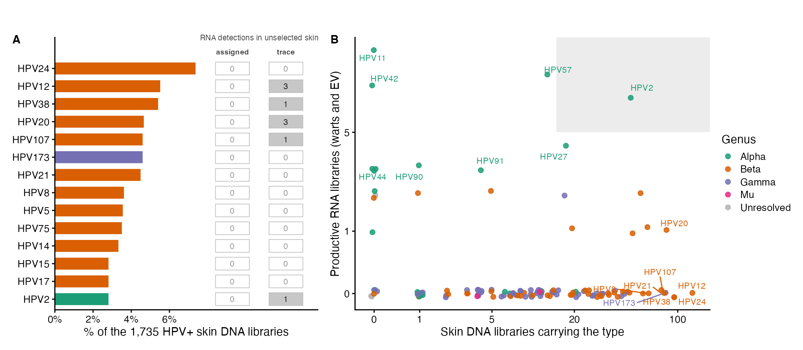

## Results

### HPV signal in public RNA-seq is dominated by non-primary material

Across the unbiased sweep, HPV positivity concentrated in cultured and engineered material: engineered libraries were positive in `r f2(stats$eng_pct)`% and cell lines in `r f2(stats$cl_pct)`%, against `r f2(stats$clin_pct)`% of clinical primary tissue (@tbl-positivity), roughly five-fold higher odds for both (engineered OR `r fo(stats$eng_or)`, *P* = `r fp(stats$eng_or_p)`; cell line OR `r fo(stats$cl_or)`, *P* = `r fp(stats$cl_or_p)`). These positives were almost entirely mucosal alpha types. HPV18 met the assignment criterion in `r stats$hpv18_tot` libraries cohort-wide, of which `r stats$hpv18_cl` were cell lines and none were tissue; HPV16 in `r stats$hpv16_tot`, of which `r stats$hpv16_cl` were cell lines. This is the signature of integrated-HPV lines and their documented contamination of archived data. Genuine primary skin therefore shows detectable HPV transcription in only 2–4% of libraries. Much of the apparent HPV signal in public transcriptomes likely reflects laboratory-derived artifacts, which must be separated out before any prevalence claim.

| Sample class | Libraries (*n*) | HPV+ (*n*) | HPV+ % (95% CI) | Odds ratio (95% CI) | *P* |
|:-----------|-----------:|-----------:|:----------:|:----------:|:----------:|
| Clinical (primary tissue) | `r comma(stats$clin_n)` | `r stats$clin_pos` | `r f2(stats$clin_pct)` (`r pci(stats$clin_lo, stats$clin_hi)`) | 1 (reference) | n/a |
| Engineered | `r comma(stats$eng_n)` | `r stats$eng_pos` | `r f2(stats$eng_pct)` (`r pci(stats$eng_lo, stats$eng_hi)`) | `r fo(stats$eng_or)` (`r oci(stats$eng_or_lo, stats$eng_or_hi)`) | `r fp(stats$eng_or_p)` |
| Cell line | `r comma(stats$cl_n)` | `r stats$cl_pos` | `r f2(stats$cl_pct)` (`r pci(stats$cl_lo, stats$cl_hi)`) | `r fo(stats$cl_or)` (`r oci(stats$cl_or_lo, stats$cl_or_hi)`) | `r fp(stats$cl_or_p)` |

: HPV positivity by sample provenance. HPV-positive calls (Kraken2 ≥ 10 papillomavirus reads) among `r comma(stats$n_screened)` screened libraries. Percentages carry Wilson 95% confidence intervals; odds ratios are from logistic regression against clinical primary tissue (likelihood-ratio *P* = `r fp(stats$lr_p)`). Cell-line and engineered libraries carry roughly five-fold higher odds than primary tissue, and their positives are predominantly the integrated mucosal types HPV16 and HPV18. {#tbl-positivity}

The transcripts carry an independent signature of that artifact. E1 and E2 lie on the same early message, so their counts should track unless integration disrupts E2; cell lines show a median E1:E2 ratio of `r fo(stats$e1e2_cl)` against `r formatC(stats$e1e2_ctrl, format="f", digits=2)` in productive controls and `r formatC(stats$e1e2_skin, format="f", digits=2)` in skin, separating cultured from productive primary infection almost completely (AUC 0.97; @fig-integration). Virus-host junction calling confirms it, provided junctions are scored as clustering rather than raw count. The ratio also rises monotonically with grade in an independent HPV16-positive cervical series: the median ratio runs from `r formatC(2^stats$cxg_norm, format="f", digits=2)` in normal epithelium through `r formatC(2^stats$cxg_hsil, format="f", digits=2)` in high-grade lesion to `r formatC(2^stats$cxg_scc, format="f", digits=2)` in carcinoma, a `r formatC(2^(stats$cxg_scc - stats$cxg_norm), format="f", digits=1)`-fold rise (@fig-integration c, plotted on the log~2~ scale). Late transcription falls away along the same axis. The carcinoma median still sits well below the cell-line median. This fits either a mixture of integrated and episomal genomes or admixture of non-tumor epithelium in a bulk biopsy. The rise in primary tissue suggests that the marker reflects viral integration as a biological process rather than merely culture-derived artifacts.

::: {#fig-integration}

Integration read from viral transcription. (**a**) E1:E2 transcript ratio by group, log~2~((E1 + 0.5)/(E2 + 0.5)), for libraries with at least five combined reads; dashed line, parity. The episomal HPV31-positive HaCaT derivative falls among primary tissue. (**b**) Virus-host chimeric junctions: the fraction at a library's most-supported coordinate pair against the raw junction count; dashed gray line, the 0.2 clustering threshold. (**c**) E1:E2 ratio in a graded HPV16-positive cervical series (SRP252916) of normal epithelium, high-grade squamous intraepithelial lesion (HSIL) and carcinoma, sequenced under one protocol. Open circles, libraries (*n* = `r stats$cxg_norm_n`, `r stats$cxg_hsil_n` and `r stats$cxg_scc_n` by grade; the HPV-negative controls returned no HPV and are not plotted); filled diamonds, arm medians joined by a solid line; dashed line, parity.
:::

### Skin neoplasia carries trace HPV, not productive infection

Every library, including negatives, was scored as papillomavirus reads per million (RPM). Productive controls (warts, condyloma) reached the control-calibrated detection floor (`r p1(stats$floor_rpm)` RPM) in `r pp(stats$ctrl_pctfloor)`% of libraries, and EV biopsies in `r pp(stats$ev_pctfloor)`%, with median burdens of `r comma(stats$ctrl_medrpm)` and `r p1(stats$ev_medrpm)` RPM. Across `r comma(stats$neo_n)` cSCC/AK libraries only `r stats$neo_pos_floor` reached it (`r pp(stats$neo_pctfloor)`%), median burden `r formatC(stats$neo_medrpm, format="f", digits=3)` RPM, six orders of magnitude lower (@fig-rpm; Fisher OR `r fo(stats$fish_or)`, *P* = `r fp(stats$fish_p)`).

::: {#fig-rpm}

Depth-normalized HPV transcript burden by sample group. Each point is one screened library, scored as papillomavirus reads per million; boxes show median and interquartile range and the *y*-axis is log~10~-scaled. The dashed red line is the control-calibrated detection floor (`r p1(stats$floor_rpm)` RPM, the 5th percentile of non-cell-line productive controls). Productive controls and EV biopsies lie far above it, whereas cutaneous neoplasia and unselected skin sit near zero despite neoplasia being sequenced almost four times more deeply than the productive controls (median `r mreads(stats$neo_medreads)` vs `r mreads(stats$ctrl_medreads)` reads). Group assignment is by metadata precedence with curated corrections.
:::

This gap is not depth. Neoplasia libraries were sequenced almost four times more deeply than the productive controls (median `r mreads(stats$neo_medreads)` vs `r mreads(stats$ctrl_medreads)` reads), and depth raised the odds of any HPV read (OR per log₁₀ reads `r fo(stats$m2a_l10_or)`, *P* = `r fp(stats$m2a_l10_p)`) without raising the odds of reaching the floor, either across groups (OR `r fo(stats$m2b_l10_or)`, *P* = `r fp(stats$m2b_l10_p)`) or within neoplasia alone (OR `r fo(stats$neo_depth_or)`, *P* = `r fp(stats$neo_depth_p)`). The deepest cSCC/AK libraries, at `r p1(stats$neo_maxreads)`M reads, did not cross it, and the same holds within matched depth bins (@suppfig-depth).

Nor is it library chemistry, the other bound on viral recovery. Chemistry was resolved for `r comma(stats$chem_n)` libraries (`r pp(stats$chem_pct)`%) from SRA metadata and construction-protocol text, and its imbalance runs against the negative result: neoplasia is rRNA-depleted in `r pp(stats$chem_neo_ribo)`% of libraries against `r pp(stats$chem_skin_ribo)`% of unselected skin (@supptbl-chem), while the productive controls contain none. Adjusting for depth and group, rRNA-depleted libraries were no likelier than poly-A to carry an HPV read (OR `r fo(stats$chem_ribo_or)`, 95% CI `r oci(stats$chem_ribo_lo, stats$chem_ribo_hi)`), and among the `r comma(stats$ribo_n)` rRNA-depleted libraries alone, not one in either group reached the productive floor.

Pooling actinic keratosis with carcinoma is supported rather than assumed: the `r stats$ak_n` AK and `r stats$sc_n` cSCC libraries both sit well above unselected skin (trace OR `r fo(stats$ak_or)` and `r fo(stats$sc_or)`) and are indistinguishable from each other, depth-adjusted (trace OR `r fo(stats$akvs_or)`, `r oci(stats$akvs_lo, stats$akvs_hi)`, *P* = `r fp(stats$akvs_p)`; floor detection `r stats$ak_floor`/`r stats$ak_n` against `r stats$sc_floor`/`r stats$sc_n`, Fisher *P* = `r fp(stats$akvf_p)`).

Tissue that cannot host the virus fixes the meaning of that trace. Cutaneous adipose, blood and neural material offer no permissive compartment, yet the `r stats$npt_n` such libraries carried a trace HPV read at `r pp(stats$npt_pctany)`%, indistinguishable from the `r pp(stats$uns_pctany)`% of unselected skin, and not one yielded an assignable type. The background trace rate is the assay's floor, reproduced where infection is impossible. Decomposing the below-floor libraries by gene puts a mechanism under that floor: `r tr("trace_pct_nogene")`% of the `r tr("trace_n")` below-floor skin and neoplasia libraries carry no reads on any HPV gene, and only `r tr("trace_pct_prod")`% reach the productive threshold, against `r tr("ctrl_pct_prod")`% of productive controls (@suppfig-trace). Unselected skin, once EV material swept in by the targeted queries is reassigned, forms an almost clean null: `r pp(stats$uns_pctfloor)`% of `r comma(stats$uns_n)` libraries reach the floor. All principal contrasts were refitted as Bayesian logistic regressions under weakly-informative priors, with concordant results (@supptbl-bayes).

The transcript program makes the distinction visible (@fig-orf). Productive groups run the complete viral program, capsid genes included (L1 in `r pp(stats$orf_ctrl_l1)`% of productive controls, `r pp(stats$orf_ev_l1)`% of EV; @fig-orf a). Skin and neoplasia are not a truncated program but a uniformly faint one, low across all six frames alike (unselected skin `r pp(stats$orf_skin_e6)`% for E6, `r pp(stats$orf_skin_l1)`% for L1). Cell lines are the third shape: E6 and E7 in `r pp(stats$orf_cl_e6)`% and `r pp(stats$orf_cl_e7)`% against E2 in `r pp(stats$orf_cl_e2)`% and L2 in `r pp(stats$orf_cl_l2)`%. In composition (@fig-orf b), productive controls place `r pp(stats$orfc_ctrl_late)`% of viral reads on late genes against `r pp(stats$orfc_ctrl_onco)`% on the oncogenes; cell lines invert this exactly. Read one library at a time, the same split falls out of the criterion itself, productive controls and EV above the L1 ≥ 3 threshold and skin and neoplasia below (@fig-orf c).

::: {#fig-orf}

The viral transcriptional program by sample group. All panels are conditional on HPV positivity and successful typing, so none is a prevalence statement; group *n* is on each panel. (**a**) Percentage of a group's libraries carrying at least one read on each open reading frame, as a Beta-Binomial posterior mean. Productive groups transcribe the whole genome including the capsid genes, skin and neoplasia are uniformly low across all frames, and cultured material retains the oncogenes while losing E2 and the late genes. (**b**) Mean share of viral reads per frame, among libraries with at least 20 viral reads. (**c**) Early-region against L1 reads per library, with the L1 ≥ 3 productive threshold drawn.
:::

### The assay detects genuine productive cutaneous infection where it occurs

Among HPV-positive typed samples, `r round(stats$m3_ctrl_pct)`% of targeted wart/EV libraries met the L1 criterion against `r pp(stats$m3_neo_pct)`% of cSCC/AK (OR `r fo(stats$m3_or)`, *P* = `r fp(stats$m3_p)`), spanning the expected cutaneous repertoire. A minority of genuine primary-skin lesions carried unambiguous productive infection, most strikingly an HPV12-productive cSCC and two lesions co-infected with the beta types HPV96 and HPV182 at near-complete genome coverage (@supptbl-productive); co-infection by two assigned types is itself common enough to tabulate (@supptbl-coinf). The type landscape is partitioned by population (@fig-genus; by type in @supptbl-types, @supptbl-trace and @suppfig-types): high-risk mucosal HPV16/18 confined almost entirely to cultured material, cutaneous wart and low-risk types in productive controls, the defining beta types in EV, and a beta/gamma reservoir in healthy skin visible mainly below the assignment threshold. Most of the small floor-level excess in neoplasia is attributable to `r stats$cin_n` mucosal HPV16 cases the broadened query captured (@supptbl-cin); excluding them halves it, to `r pp(stats$neo_pctfloor_cut)`%.

::: {#fig-genus}

HPV genus prevalence by sample group. Rows show the assigned-type catalog, the detection-level trace catalog and their union, collapsed from type to genus; a library contributes to at most one of the first two rows. Each point is the percentage of the group's libraries carrying the genus (Beta-Binomial posterior mean, Beta(0.5, 0.5) prior), the bar its 95% credible interval, and the number above it the count of libraries. Gray crosses mark a genus never detected in that group, drawn at the floor of the log-scaled *y*-axis, where the tick labeled 0 stands for zero.
:::

### The reservoir is independently present in public skin DNA

Silence is only informative against a reservoir known to exist, so we re-tabulated a petabase-scale papillomavirus catalog of public metagenome assemblies [@shenpv2026; @chikhi2024] by body site (Methods). Skin metagenomes contribute `r comma(rvn("n_skin_lib"))` HPV-positive libraries with a cutaneous commensal composition (beta `r p1(rvn("skin_beta"))`%, gamma `r p1(rvn("skin_gamma"))`%, alpha `r p1(rvn("skin_alpha"))`%), while the same procedure returns the mucosal niche for vaginal metagenomes (alpha `r p1(rvn("vaginal_alpha"))`%), so the read-out is not assembly noise (@suppfig-reservoir-gut). The `r rv("top_n")` commonest reservoir types are beta and gamma but for HPV2, and our detection level sees them only as a trace: across our `r comma(rvn("n_skin_rna"))` unselected-skin libraries they account for `r rvn("topn_rna_assigned")` assigned and `r rvn("topn_rna_trace")` trace detections (@fig-reservoir a). Across all `r rv("n_types_cmp")` types the disagreement is general: `r rv("n_dna_present_silent")` of the `r rv("n_dna_present")` types present in the reservoir are productive in no library here, and `r rv("corner_types")` alone is both abundant in skin DNA and productive in our RNA (@fig-reservoir b). HPV8, the beta type most often named as the cutaneous carcinoma candidate in serological and DNA studies, is the sharpest case: it is the eighth commonest type in the reservoir, carried by `r rv("hpv8_dna")` of the `r comma(rvn("n_skin_lib"))` HPV-positive skin DNA libraries, yet it appears in `r rv("hpv8_rna_all")` of the `r comma(rvn("n_rna_all"))` RNA libraries screened here, at any level and whether assigned or trace.

::: {#fig-reservoir}

The skin HPV DNA reservoir against its transcriptional silence. Re-tabulation of a Logan-wide papillomavirus catalog [@shenpv2026] by body site, restricted to skin (Methods; body-site validation in @suppfig-reservoir-gut). (**a**) The `r rv("top_n")` commonest types in the skin reservoir, as a percentage of the `r comma(rvn("n_skin_lib"))` HPV-positive skin DNA libraries (composition, not prevalence: a co-infected library counts under each type). Beside each bar are the type's assigned and detection-level counts among the `r comma(rvn("n_skin_rna"))` unselected-skin RNA libraries, shaded where non-zero. (**b**) All `r rv("n_types_cmp")` types resolved in either modality: skin DNA libraries carrying the type against libraries transcribing it productively (warts and EV), log~10~(*n* + 1), jittered. The shaded corner, abundant *and* productive, is the conjunction the reservoir-to-disease inference assumes; `r rv("corner_types")` is its only occupant.
:::
