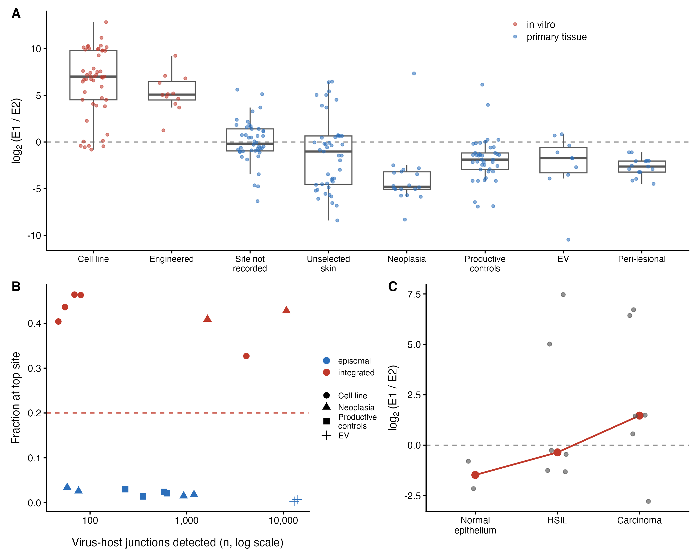
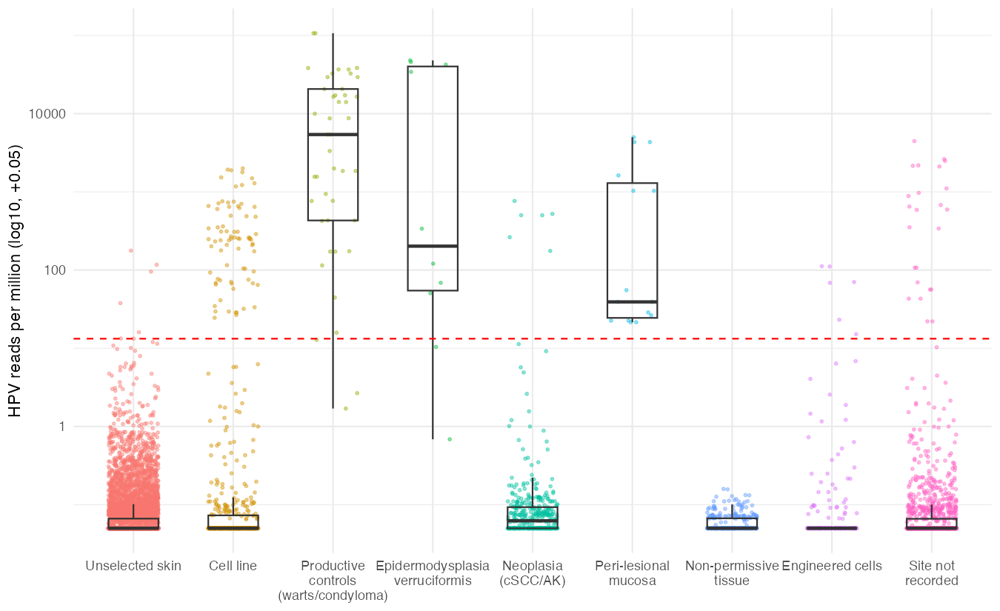
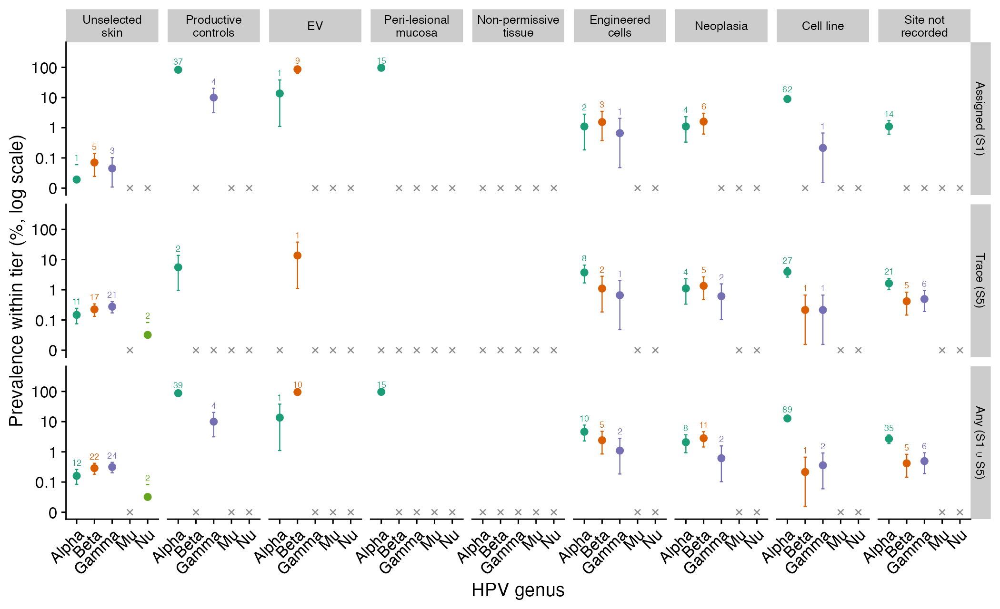

## Results

### HPV signal in public RNA-seq is dominated by non-primary material

Across the unbiased sweep, HPV positivity concentrated in cultured and engineered material: engineered libraries were positive in `r f2(stats$eng_pct)`% and cell lines in `r f2(stats$cl_pct)`%, against `r f2(stats$clin_pct)`% of clinical primary tissue (@tbl-positivity), roughly five-fold higher odds for both (engineered OR `r fo(stats$eng_or)`, *P* = `r fp(stats$eng_or_p)`; cell line OR `r fo(stats$cl_or)`, *P* = `r fp(stats$cl_or_p)`). These positives were almost entirely mucosal alpha types: HPV18 accounted for `r stats$hpv18_cl`/`r stats$hpv18_tot` of its calls in cell lines and HPV16 for `r stats$hpv16_cl`/`r stats$hpv16_tot`, the signature of integrated-HPV lines and their documented contamination of archived data. Genuine primary skin therefore carries HPV at only 2–4%, and the apparent abundance of HPV in public transcriptomes is largely a laboratory artefact that must be partitioned out before any prevalence claim.

| Sample class | Libraries (*n*) | HPV+ (*n*) | HPV+ % (95% CI) | Odds ratio (95% CI) | *P* |
|:---|---:|---:|:---:|:---:|:---:|
| Clinical (primary tissue) | `r comma(stats$clin_n)` | `r stats$clin_pos` | `r f2(stats$clin_pct)` (`r pci(stats$clin_lo, stats$clin_hi)`) | 1 (reference) | n/a |
| Engineered | `r comma(stats$eng_n)` | `r stats$eng_pos` | `r f2(stats$eng_pct)` (`r pci(stats$eng_lo, stats$eng_hi)`) | `r fo(stats$eng_or)` (`r oci(stats$eng_or_lo, stats$eng_or_hi)`) | `r fp(stats$eng_or_p)` |
| Cell line | `r comma(stats$cl_n)` | `r stats$cl_pos` | `r f2(stats$cl_pct)` (`r pci(stats$cl_lo, stats$cl_hi)`) | `r fo(stats$cl_or)` (`r oci(stats$cl_or_lo, stats$cl_or_hi)`) | `r fp(stats$cl_or_p)` |

: HPV positivity by sample provenance. HPV-positive calls (Kraken2 ≥ 10 papillomavirus reads) among `r comma(stats$n_screened)` screened libraries. Percentages carry Wilson 95% confidence intervals; odds ratios are from logistic regression against clinical primary tissue (likelihood-ratio *P* = `r fp(stats$lr_p)`). Cell-line and engineered libraries carry roughly five-fold higher odds than primary tissue, and their positives are predominantly the integrated mucosal types HPV16 and HPV18. {#tbl-positivity}

The transcripts carry an independent signature of that artefact. E1 and E2 lie on the same early message, so their counts should track unless integration disrupts E2; cell lines show a median E1:E2 of `r fo(stats$e1e2_cl)` against `r formatC(stats$e1e2_ctrl, format="f", digits=2)` in productive controls and `r formatC(stats$e1e2_skin, format="f", digits=2)` in skin, separating cultured from productive primary infection almost completely (AUC 0.97; @fig-integration). Virus-host junction calling confirms it where scored as clustering rather than raw count, and the ratio moves monotonically with grade across an independent HPV16-positive cervical series spanning normal epithelium, high-grade lesion and carcinoma, so it reads integration as biology rather than culture as provenance: the median rises from `r formatC(stats$cxg_norm, format="f", digits=2)` in normal epithelium through `r formatC(stats$cxg_hsil, format="f", digits=2)` in high-grade lesion to `r formatC(stats$cxg_scc, format="f", digits=2)` in carcinoma, roughly eightfold in the direction integration predicts, with late transcription falling away along the same axis.

::: {#fig-integration}

Integration read from viral transcription. (**A**) E1:E2 transcript ratio by tier, log~2~((E1 + 0.5)/(E2 + 0.5)) for libraries with at least five combined reads; the dashed line is parity. In-vitro material sits far above parity and primary tissue at or below it, with the episomal HPV31-positive HaCaT derivative falling among primary tissue. (**B**) Virus-host chimeric junctions, plotted as the fraction falling at a library's most-supported coordinate pair against the raw junction count. Clustering separates the groups completely; raw counts do not, and run the other way. (**C**) The ratio rises monotonically with grade across a graded HPV16-positive cervical series of normal epithelium, high-grade lesion and carcinoma; the red line joins arm medians.
:::

### Skin neoplasia carries trace HPV, not productive infection

Productive controls (warts, condyloma) reached the control-calibrated detection floor (`r p1(stats$floor_rpm)` RPM) in `r pp(stats$ctrl_pctfloor)`% of libraries, and EV biopsies in `r pp(stats$ev_pctfloor)`%, with median burdens of `r comma(stats$ctrl_medrpm)` and `r p1(stats$ev_medrpm)` RPM. Across `r comma(stats$neo_n)` cSCC/AK libraries only `r stats$neo_pos_floor` reached it (`r pp(stats$neo_pctfloor)`%), median burden `r formatC(stats$neo_medrpm, format="f", digits=3)` RPM, six orders of magnitude lower (@fig-rpm; Fisher OR `r fo(stats$fish_or)`, *P* = `r fp(stats$fish_p)`).

::: {#fig-rpm}

Depth-normalised HPV transcript burden by population tier. Each point is one screened library, scored as papillomavirus reads per million; boxes show median and interquartile range and the *y*-axis is log~10~-scaled. The dashed red line is the control-calibrated detection floor (`r p1(stats$floor_rpm)` RPM, the 5th percentile of non-cell-line productive controls). Productive controls, EV biopsies and peri-lesional mucosa lie far above it, whereas cutaneous neoplasia and unselected skin sit near zero despite neoplasia being sequenced almost four times more deeply than the productive controls (median `r mreads(stats$neo_medreads)` vs `r mreads(stats$ctrl_medreads)` reads). Tier assignment is by metadata precedence with curated corrections.
:::

This gap is not depth. Neoplasia libraries were sequenced almost four times more deeply than the productive controls (median `r mreads(stats$neo_medreads)` vs `r mreads(stats$ctrl_medreads)` reads), and depth raised the odds of any HPV read (OR per log₁₀ reads `r fo(stats$m2a_l10_or)`, *P* = `r fp(stats$m2a_l10_p)`) without raising the odds of reaching the floor, either across tiers (OR `r fo(stats$m2b_l10_or)`, *P* = `r fp(stats$m2b_l10_p)`) or within neoplasia alone (OR `r fo(stats$neo_depth_or)`, *P* = `r fp(stats$neo_depth_p)`). The deepest cSCC/AK libraries, at `r p1(stats$neo_maxreads)`M reads, did not cross it.

Nor is it library chemistry, the other bound on viral recovery. Chemistry was resolved for `r comma(stats$chem_n)` libraries (`r pp(stats$chem_pct)`%) from SRA metadata and construction-protocol text, and its imbalance runs against the negative result: neoplasia is rRNA-depleted in `r pp(stats$chem_neo_ribo)`% of libraries against `r pp(stats$chem_skin_ribo)`% of unselected skin, while the productive controls contain none. Adjusting for depth and tier, rRNA-depleted libraries were no likelier than poly-A to carry an HPV read (OR `r fo(stats$chem_ribo_or)`, 95% CI `r oci(stats$chem_ribo_lo, stats$chem_ribo_hi)`), and among the `r comma(stats$ribo_n)` rRNA-depleted libraries alone, not one in either tier reached the productive floor.

Pooling actinic keratosis with carcinoma is supported rather than assumed: the `r stats$ak_n` AK and `r stats$sc_n` cSCC libraries both sit well above unselected skin (trace OR `r fo(stats$ak_or)` and `r fo(stats$sc_or)`) and are indistinguishable from each other, depth-adjusted (trace OR `r fo(stats$akvs_or)`, `r oci(stats$akvs_lo, stats$akvs_hi)`, *P* = `r fp(stats$akvs_p)`; floor detection `r stats$ak_floor`/`r stats$ak_n` against `r stats$sc_floor`/`r stats$sc_n`, Fisher *P* = `r fp(stats$akvf_p)`).

Tissue that cannot host the virus fixes the meaning of that trace. Cutaneous adipose, blood and neural material offer no permissive compartment, yet the `r stats$npt_n` such libraries carried a trace HPV read at `r pp(stats$npt_pctany)`%, indistinguishable from the `r pp(stats$uns_pctany)`% of unselected skin, and not one yielded an assignable type. The background trace rate is the assay's floor, reproduced where infection is impossible. Unselected skin, once peri-lesional and EV material swept in by the targeted queries is reassigned, forms an almost clean null: `r pp(stats$uns_pctfloor)`% of `r comma(stats$uns_n)` libraries reach the floor. All principal contrasts were refitted as Bayesian logistic regressions under weakly-informative priors, with concordant results (@supptbl-bayes).

The transcript programme makes the distinction visible (@fig-orf). Productive tiers run the complete viral programme, capsid genes included (L1 in `r pp(stats$orf_ctrl_l1)`% of productive controls, `r pp(stats$orf_ev_l1)`% of EV). Skin and neoplasia are not a truncated programme but a uniformly faint one, low across all six frames alike (unselected skin `r pp(stats$orf_skin_e6)`% for E6, `r pp(stats$orf_skin_l1)`% for L1). Cell lines are the third shape: E6 and E7 in `r pp(stats$orf_cl_e6)`% and `r pp(stats$orf_cl_e7)`% against E2 in `r pp(stats$orf_cl_e2)`% and L2 in `r pp(stats$orf_cl_l2)`%. In composition, productive controls place `r pp(stats$orfc_ctrl_late)`% of viral reads on late genes against `r pp(stats$orfc_ctrl_onco)`% on the oncogenes; cell lines invert this exactly.

::: {#fig-orf}

The viral transcriptional programme by population tier. All panels are conditional on HPV positivity and successful typing, so none is a prevalence statement; tier *n* is on each panel. (**A**) Percentage of a tier's libraries carrying at least one read on each open reading frame, as a Beta-Binomial posterior mean. Productive tiers transcribe the whole genome including the capsid genes, skin and neoplasia are uniformly low across all frames, and cultured material retains the oncogenes while losing E2 and the late genes. (**B**) Mean share of viral reads per frame, among libraries with at least 20 viral reads. (**C**) Early-region against L1 reads per library, with the L1 ≥ 3 productive threshold drawn.
:::

### The assay detects genuine productive cutaneous infection where it occurs

Among HPV-positive typed samples, `r round(stats$m3_ctrl_pct)`% of targeted wart/EV libraries met the L1 criterion against `r pp(stats$m3_neo_pct)`% of cSCC/AK (OR `r fo(stats$m3_or)`, *P* = `r fp(stats$m3_p)`), spanning the expected cutaneous repertoire. A minority of genuine primary-skin lesions carried unambiguous productive infection, most strikingly an HPV12-productive cSCC and two lesions co-infected with the gamma types HPV96 and HPV182 at near-complete genome coverage. The type landscape is partitioned by population (@fig-genus): high-risk mucosal HPV16/18 confined almost entirely to cultured material, cutaneous wart and low-risk types in productive controls, the defining beta types in EV, and a beta/gamma reservoir in healthy skin visible mainly below the assignment threshold. Most of the small floor-level excess in neoplasia is attributable to `r stats$cin_n` mucosal HPV16 cases the broadened query captured; excluding them halves it, to `r pp(stats$neo_pctfloor_cut)`%.

::: {#fig-genus}

HPV genus prevalence by population tier. The assigned-type catalogue, the detection-tier trace catalogue, and their union, collapsed from HPV type to genus, with a library contributing to at most one row. High-risk mucosal alpha types concentrate in cultured and engineered material, the cutaneous beta and gamma genera dominate healthy skin and EV, and productive controls carry the wart-associated alpha and mu types. The trace tier is where the healthy-skin beta/gamma reservoir becomes visible, most of it falling below the criterion for a type assignment.
:::

