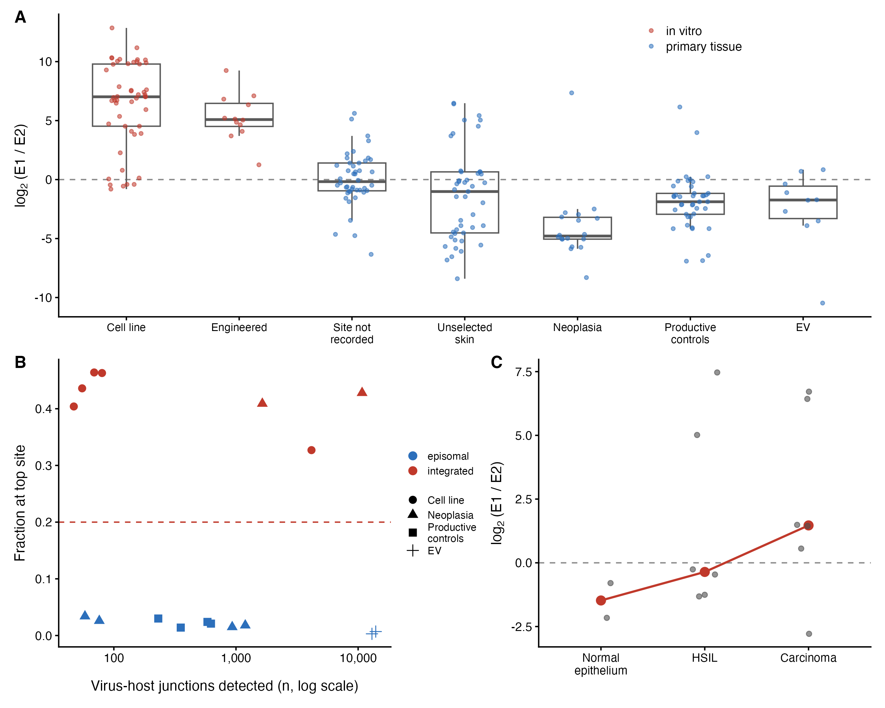
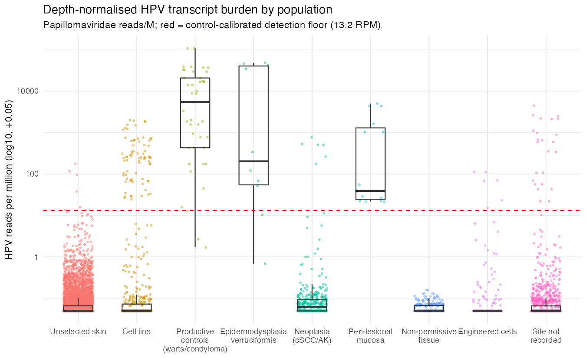
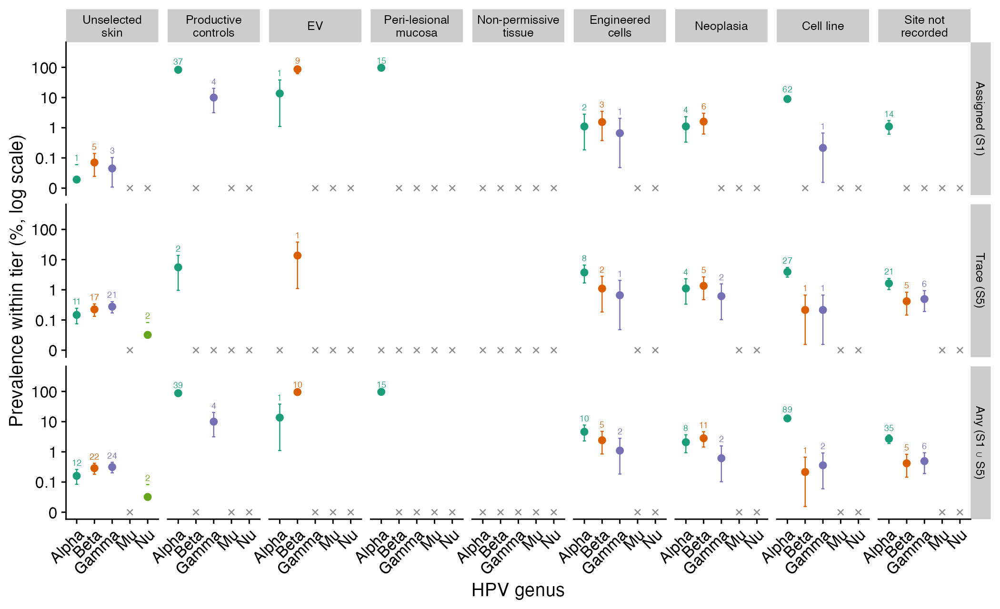
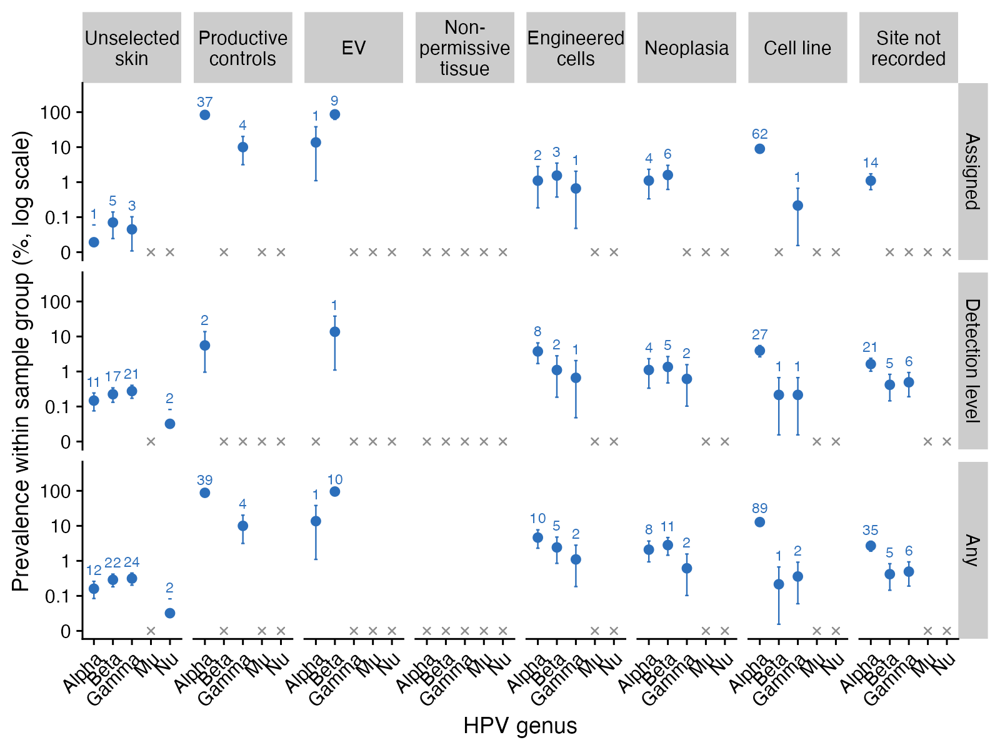
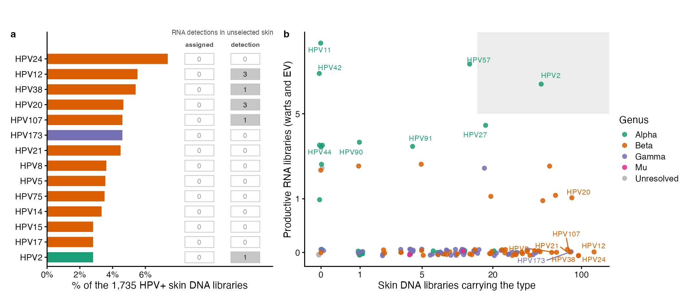

## Results

### HPV signal in public RNA-seq is dominated by nonprimary material

We assembled the cohort from three kinds of searches of the Sequence Read Archive (SRA): an untargeted search of human skin and related tissues, which supplied the unselected-skin group; a targeted search for warts, condyloma, and EV, which supplied the productive controls; and a broadened search for cSCC and actinic keratosis (AK) (Materials and Methods). Each library was classed from its metadata as a cell line (an established or immortalized line, such as HeLa or HaCaT), as engineered (cells genetically modified by RNA interference, CRISPR, transfection, or viral transduction), or otherwise as clinical primary tissue. Across the `r comma(stats$n_screened)` screened libraries, HPV positivity concentrated in cultured and engineered material. Engineered libraries were positive in `r f2(stats$eng_pct)`% and cell lines in `r f2(stats$cl_pct)`%, compared with `r f2(stats$clin_pct)`% of clinical primary tissue (@tbl-positivity), roughly four-fold higher odds for both (engineered OR `r fo(stats$eng_or)`, *P* = `r fp(stats$eng_or_p)`; cell line OR `r fo(stats$cl_or)`, *P* = `r fp(stats$cl_or_p)`). These positives were almost entirely mucosal alpha types. HPV18 met the assignment criterion in `r stats$hpv18_tot` libraries cohort-wide, of which `r stats$hpv18_cl` were cell lines and none were tissue; HPV16 did so in `r stats$hpv16_tot`, of which `r stats$hpv16_cl` were cell lines. This is the signature of integrated-HPV lines and their documented contamination of archived data. Genuine primary skin therefore shows detectable HPV transcription in only 2–3% of libraries. Much of the apparent HPV signal in public transcriptomes likely reflects laboratory-derived artifacts, which must be separated out before any prevalence claim.

::: {#tbl-positivity}
| Sample class | Libraries (*n*) | HPV+ (*n*) | HPV+ % (95% CI) | Odds ratio (95% CI) | *P* |
|:-----------|-----------:|-----------:|:----------:|:----------:|:----------:|
| Clinical (primary tissue) | `r comma(stats$clin_n)` | `r stats$clin_pos` | `r f2(stats$clin_pct)` (`r pci(stats$clin_lo, stats$clin_hi)`) | 1 (reference) | n/a |
| Engineered | `r comma(stats$eng_n)` | `r stats$eng_pos` | `r f2(stats$eng_pct)` (`r pci(stats$eng_lo, stats$eng_hi)`) | `r fo(stats$eng_or)` (`r oci(stats$eng_or_lo, stats$eng_or_hi)`) | `r fp(stats$eng_or_p)` |
| Cell line | `r comma(stats$cl_n)` | `r stats$cl_pos` | `r f2(stats$cl_pct)` (`r pci(stats$cl_lo, stats$cl_hi)`) | `r fo(stats$cl_or)` (`r oci(stats$cl_or_lo, stats$cl_or_hi)`) | `r fp(stats$cl_or_p)` |

HPV-positive calls (Kraken2 ≥ 10 papillomavirus reads) among `r comma(stats$n_screened)` screened libraries. The denominator is the libraries that returned a screening result; the `r comma(stats$n_unscreened)` that returned none are excluded (Supplementary Materials and Methods). Percentages carry Wilson 95% confidence intervals; odds ratios are from logistic regression against clinical primary tissue (likelihood-ratio *P* = `r fp(stats$lr_p)`). CI, confidence interval; HPV+, HPV positive.

**HPV positivity by sample origin.**
:::

Viral transcription offers a second way to recognize cell-line material, independent of metadata. E1 and E2 lie in the same early transcription unit [@sankovski2014; @rehm2022jvi], so their counts should track one another unless integration disrupts E2. Cell lines carry integrated HPV DNA and showed a median E1:E2 ratio of `r fo(stats$e1e2_cl)`, compared with `r formatC(stats$e1e2_ctrl, format="f", digits=2)` in productive controls and `r formatC(stats$e1e2_skin, format="f", digits=2)` in skin, which separated cultured from productive primary infection almost completely (AUC 0.97; @fig-integration). Calling virus-host junctions confirmed this, provided that junctions were scored by clustering rather than by raw count. Raw counts scale with viral load (both EV libraries carry more than `r comma(floor(stats$ev_jx_min/1000)*1000)` chimeric reads, spread across more than `r comma(floor(stats$ev_jx_sites_min/1000)*1000)` sites), whereas integration appears as junctions clustered at a single site. To test whether the ratio tracks integration in primary tissue, where integration increases with disease progression, we scored a graded HPV16-positive cervical series. The median E1:E2 ratio rose with each grade, from `r formatC(2^stats$cxg_norm, format="f", digits=2)` in normal epithelium through `r formatC(2^stats$cxg_hsil, format="f", digits=2)` in high-grade lesions to `r formatC(2^stats$cxg_scc, format="f", digits=2)` in carcinoma, a `r formatC(2^(stats$cxg_scc - stats$cxg_norm), format="f", digits=1)`-fold rise (@fig-integration c, plotted on the log~2~ scale), and late transcription declined across the same grades. Even in carcinoma, however, the median E1:E2 ratio remained well below that of cell lines. This is consistent with either a mixture of integrated and episomal genomes or admixture of nontumor epithelium in bulk biopsies. The rise of the ratio with grade in primary tissue suggests that it reflects viral integration as a biological process, not only culture-derived artifacts.

::: {#fig-integration}

Viral genome state assessed by transcript analysis. (**a**) E1:E2 transcript ratio by group, log~2~((E1 + 0.5)/(E2 + 0.5)), for libraries with at least 5 combined reads; dashed line, parity. In-vitro material sits above parity and primary tissue at or below it, the episomal HPV31-positive HaCaT derivative among the latter. (**b**) Virus-host chimeric junctions: the fraction at a library's most-supported coordinate pair against the raw count; dashed gray line, the 0.2 clustering threshold. (**c**) E1:E2 ratio in a graded HPV16-positive cervical series (SRP252916) of normal epithelium, high-grade lesion (HSIL) and carcinoma, under one protocol. Open circles, libraries (*n* = `r stats$cxg_norm_n`, `r stats$cxg_hsil_n` and `r stats$cxg_scc_n` by grade; the HPV-negative controls returned no HPV and are not plotted); filled diamonds, arm medians joined by a solid line; dashed line, parity.
:::

### Skin neoplasia carries trace HPV, not productive infection

We scored every library as papillomavirus reads per million (RPM), including libraries below the HPV-positivity threshold of 10 reads (any-HPV). We set a detection floor of `r p1(stats$floor_rpm)` RPM, the 5th percentile of productive controls from primary tissue; HPV below it we call trace. Productive controls (warts, condyloma) reached this floor in `r pp(stats$ctrl_pctfloor)`% of libraries and EV biopsies in `r pp(stats$ev_pctfloor)`%, with median viral loads of `r comma(stats$ctrl_medrpm)` and `r p1(stats$ev_medrpm)` RPM. Of the `r comma(stats$neo_n)` cSCC/AK libraries, only `r stats$neo_pos_floor` reached the floor (`r pp(stats$neo_pctfloor)`%), with a median viral load of `r formatC(stats$neo_medrpm, format="f", digits=3)` RPM, more than `r nword(floor(log10(stats$ctrl_medrpm / stats$neo_medrpm)))` orders of magnitude lower (@fig-rpm; Fisher OR `r fo(stats$fish_or)`, *P* = `r fp(stats$fish_p)`).

::: {#fig-rpm}

Depth-normalized HPV transcript burden by sample group. Each point is one analyzed library, scored as papillomavirus reads per million; boxes show median and interquartile range and the *y*-axis is log~10~-scaled. The dashed red line is the control-calibrated detection floor (`r p1(stats$floor_rpm)` RPM, the 5th percentile of non-cell-line productive controls). Group assignment is by metadata precedence with curated corrections.
:::

Sequencing depth did not explain this difference between neoplasia and productive controls. Neoplasia libraries were sequenced almost `r nword(stats$neo_medreads / stats$ctrl_medreads)` times more deeply than the productive controls (median `r mreads(stats$neo_medreads)` vs `r mreads(stats$ctrl_medreads)` reads). Greater depth raised the odds of finding any HPV read (OR per log₁₀ reads `r fo(stats$m2a_l10_or)`, *P* = `r fp(stats$m2a_l10_p)`) but not the odds of reaching the floor, either across groups (OR `r fo(stats$m2b_l10_or)`, *P* = `r fp(stats$m2b_l10_p)`) or within neoplasia alone (OR `r fo(stats$neo_depth_or)`, *P* = `r fp(stats$neo_depth_p)`). The deepest cSCC/AK libraries, at `r p1(stats$neo_maxreads)`M reads, did not reach the floor, and the same holds within matched depth bins (@suppfig-depth).

Library chemistry also limits viral recovery, but it did not explain the difference either. Chemistry was resolved for `r comma(stats$chem_n)` libraries (`r pp(stats$chem_pct)`%) from SRA metadata and construction-protocol text. Its imbalance between groups would work against our negative result, not produce it. Neoplasia libraries were rRNA-depleted more often than unselected skin (`r pp(stats$chem_neo_ribo)`% vs `r pp(stats$chem_skin_ribo)`%; @supptbl-chem), and the productive controls contained no rRNA-depleted libraries. Adjusting for depth and group, rRNA-depleted libraries were no likelier than poly-A libraries to carry an HPV read (OR `r fo(stats$chem_ribo_or)`, 95% CI `r oci(stats$chem_ribo_lo, stats$chem_ribo_hi)`), and among the `r comma(stats$ribo_n)` rRNA-depleted libraries alone, no neoplasia or unselected-skin library reached the productive floor.

AK and cSCC were indistinguishable, which justifies analyzing them together. Both the `r stats$ak_n` AK and the `r stats$sc_n` cSCC libraries carried any-HPV reads more often than unselected skin (any-HPV OR `r fo(stats$ak_or)` and `r fo(stats$sc_or)`), and they did not differ from each other after adjustment for depth (any-HPV OR `r fo(stats$akvs_or)`, 95% CI `r oci(stats$akvs_lo, stats$akvs_hi)`, *P* = `r fp(stats$akvs_p)`; floor detection `r stats$ak_floor`/`r stats$ak_n` vs `r stats$sc_floor`/`r stats$sc_n`, Fisher *P* = `r fp(stats$akvf_p)`).

To interpret this trace, we examined tissues that HPV cannot infect. Cutaneous adipose tissue, blood, and neural tissue contain no cells that support HPV infection, yet `r pp(stats$npt_pctany)`% of the `r stats$npt_n` such libraries carried an any-HPV read, a rate similar to that of unselected skin (`r pp(stats$uns_pctany)`%), and none yielded an assignable HPV type. The any-HPV rate in skin is therefore the background of the assay, reproduced where infection is impossible. Splitting the below-floor libraries by viral gene shows what this trace consists of. Two criteria are in play here and they are not the same: the detection floor is a burden threshold in RPM, whereas productivity is a capsid criterion, L1 represented by at least 3 reads. A library can therefore sit below the floor and still be scored for either. Of the `r tr("trace_n")` below-floor skin and neoplasia libraries, `r tr("trace_pct_nogene")`% carried no reads on any HPV gene, and only `r tr("trace_pct_prod")`% met the productive criterion of L1 represented by at least 3 reads, compared with `r tr("ctrl_pct_prod")`% of productive controls (@suppfig-trace). With EV libraries assigned to their own group, unselected skin is an almost clean null, with only `r pp(stats$uns_pctfloor)`% of `r comma(stats$uns_n)` libraries reaching the floor.

The viral transcription program separates productive infection from this trace (@fig-orf). Productive groups transcribe the complete viral program, including the late mRNAs that encode the capsid proteins (L1 in `r pp(stats$orf_ctrl_l1)`% of productive controls and `r pp(stats$orf_ev_l1)`% of EV libraries; @fig-orf a). In skin and neoplasia, the program was not truncated but uniformly faint, low across all six open reading frames alike (unselected skin, `r pp(stats$orf_skin_e6)`% for E6 and `r pp(stats$orf_skin_l1)`% for L1). Cell lines showed a third pattern, with E6 and E7 in `r pp(stats$orf_cl_e6)`% and `r pp(stats$orf_cl_e7)`% of libraries but E2 in only `r pp(stats$orf_cl_e2)`% and L2 in `r pp(stats$orf_cl_l2)`%. In composition (@fig-orf b), productive controls placed `r pp(stats$orfc_ctrl_late)`% of viral reads on late genes and `r pp(stats$orfc_ctrl_onco)`% on the oncogenes, whereas cell lines showed the reverse. In individual libraries the two distributions overlap rather than separate (@fig-orf c): most productive-control and EV libraries sit above the L1 ≥ 3 threshold and most skin and neoplasia libraries below it, but each group has members on the other side, and `r tr("trace_pct_prod")`% of below-floor skin and neoplasia libraries meet the criterion, as above.

::: {#fig-orf}

The viral transcription program by sample group. All panels are conditional on HPV positivity and successful typing, so none is a prevalence statement; group *n* is on each panel. (**a**) Percentage of a group's libraries carrying at least one read on each open reading frame, as a Beta-Binomial posterior mean. (**b**) Mean share of viral reads per frame, among libraries with at least 20 viral reads. (**c**) Early-region against L1 reads per library, with the L1 ≥ 3 productive threshold drawn.
:::

### The assay detects genuine productive cutaneous infection where it occurs

Among HPV-positive typed samples, `r round(stats$m3_ctrl_pct)`% of targeted wart and EV libraries met the L1 criterion, compared with `r pp(stats$m3_neo_pct)`% of cSCC/AK libraries (OR `r fo(stats$m3_or)`, *P* = `r fp(stats$m3_p)`), spanning the expected cutaneous repertoire. A minority of genuine primary-skin lesions carried unambiguous productive infection, notably an HPV12-productive cSCC and 2 lesions coinfected with the beta types HPV96 and HPV182 at near-complete genome coverage (@supptbl-productive). Coinfection by two assigned types is itself common enough to tabulate (@supptbl-coinf). The HPV types differed by sample group (@fig-genus; by type in @supptbl-types, @supptbl-detection and @suppfig-types). High-risk mucosal HPV16 and HPV18 were confined almost entirely to cultured material, cutaneous wart and low-risk types to productive controls, and the defining beta types to EV, whereas healthy skin carried a beta/gamma reservoir visible mainly below the assignment threshold. Most of the small floor-level excess in neoplasia is attributable to `r stats$cin_n` mucosal HPV16 cases captured by the broadened cSCC/AK search (@supptbl-cin); excluding them halves it, to `r pp(stats$neo_pctfloor_cut)`%.

::: {#fig-genus}

HPV genus prevalence by sample group. Rows show the assigned-type catalog, the detection-level catalog and their union, collapsed from type to genus; a library contributes to at most one of the first two rows. Each point is the percentage of the group's libraries carrying the genus (Beta-Binomial posterior mean, Beta(0.5, 0.5) prior), the bar its 95% credible interval, and the number above it the count of libraries. Gray crosses mark a genus never detected in that group, drawn at the floor of the log-scaled *y*-axis, where the tick labeled 0 stands for zero.
:::

### The reservoir is independently present in public skin DNA

The absence of HPV transcription in skin is informative only if HPV genomes are present there. We therefore tabulated, by body site, the HPV types in a petabase-scale papillomavirus catalog assembled from public metagenomes^[Shen JYQ, Korobeynikov A, Chikhi R, Babaian A. Petabase-scale papillomavirus discovery. eLife 2026; doi:10.7554/eLife.111778 (Reviewed Preprint version 1, 16 July 2026; not yet a version of record). Chikhi R, Raffestin B, Korobeynikov A, Edgar R, Babaian A. Logan: planetary-scale genome assembly surveys life's diversity. bioRxiv 2024; doi:10.1101/2024.07.30.605881.] (Methods). Skin metagenomes contributed `r comma(rvn("n_skin_lib"))` HPV-positive libraries with a cutaneous commensal composition (beta `r p1(rvn("skin_beta"))`%, gamma `r p1(rvn("skin_gamma"))`%, alpha `r p1(rvn("skin_alpha"))`%). Applied to vaginal metagenomes, the same procedure recovered mostly alpha types (`r p1(rvn("vaginal_alpha"))`%), which are characteristic of the mucosal niche, so the body-site composition is not an artifact of assembly (@suppfig-reservoir-gut). Of the `r rv("top_n")` most common types in the skin DNA reservoir, all except HPV2 are beta or gamma types. In our `r comma(rvn("n_skin_rna"))` unselected-skin RNA libraries, these types accounted for `r rvn("topn_rna_assigned")` assigned and `r rvn("topn_rna_trace")` detection-level calls (@fig-reservoir a). The mismatch held across all `r rv("n_types_cmp")` types. Of the `r rv("n_dna_present")` types present in the reservoir, `r rv("n_dna_present_silent")` were productive in no RNA library, and `r rv("corner_types")` alone was both abundant in skin DNA and productive in our RNA data (@fig-reservoir b). HPV8, the beta type most often proposed as a cSCC candidate in serological and DNA studies, is the clearest example. It is the eighth most common type in the reservoir, in `r rv("hpv8_dna")` of the `r comma(rvn("n_skin_lib"))` HPV-positive skin DNA libraries (`r p1(100*rvn("hpv8_dna")/rvn("n_skin_lib"))`%), yet absent at either level, assigned or detection-level, from all `r comma(rvn("n_skin_rna"))` of our unselected-skin RNA libraries and from all `r comma(rvn("n_rna_all"))` we analyzed.

::: {#fig-reservoir}

Most of the skin HPV DNA reservoir is transcriptionally silent. Tabulation of a Logan-wide papillomavirus catalog (Shen et al, 2026, eLife Reviewed Preprint) by body site, skin only (Methods; validation in @suppfig-reservoir-gut). (**a**) The `r rv("top_n")` commonest types in the skin reservoir, as a percentage of the `r comma(rvn("n_skin_lib"))` HPV-positive skin DNA libraries (composition, not prevalence: a co-infected library counts under each type). Beside each bar are the type's assigned and detection-level counts among the `r comma(rvn("n_skin_rna"))` unselected-skin RNA libraries, shaded where non-zero. (**b**) All `r rv("n_types_cmp")` types resolved in either modality: skin DNA libraries carrying the type against libraries transcribing it productively (warts and EV), log~10~(*n* + 1), jittered. The shaded corner, abundant *and* productive, is what the reservoir-to-disease inference assumes; `r rv("corner_types")` is its only occupant.
:::
