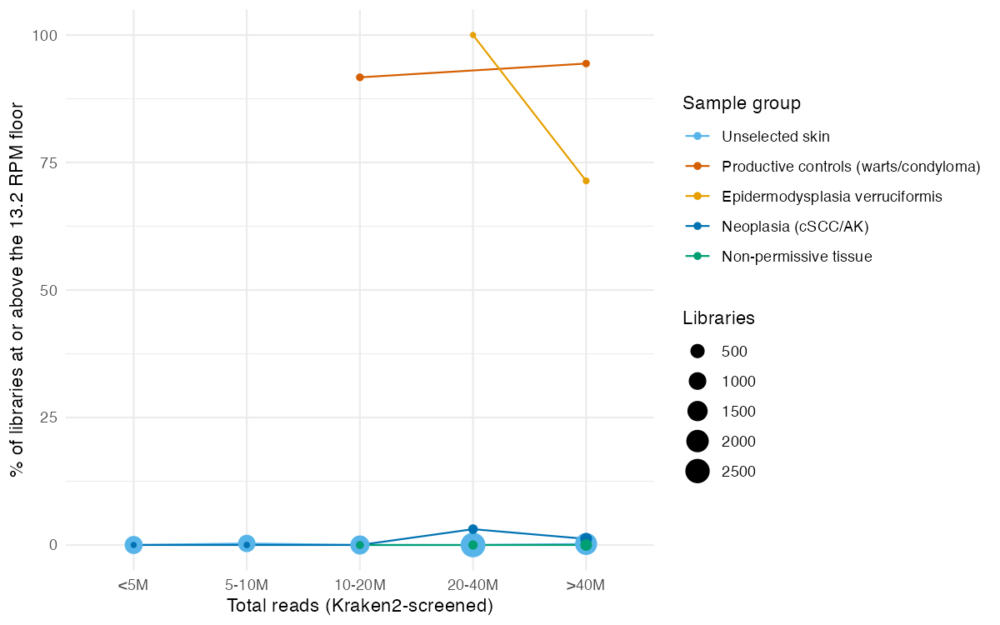
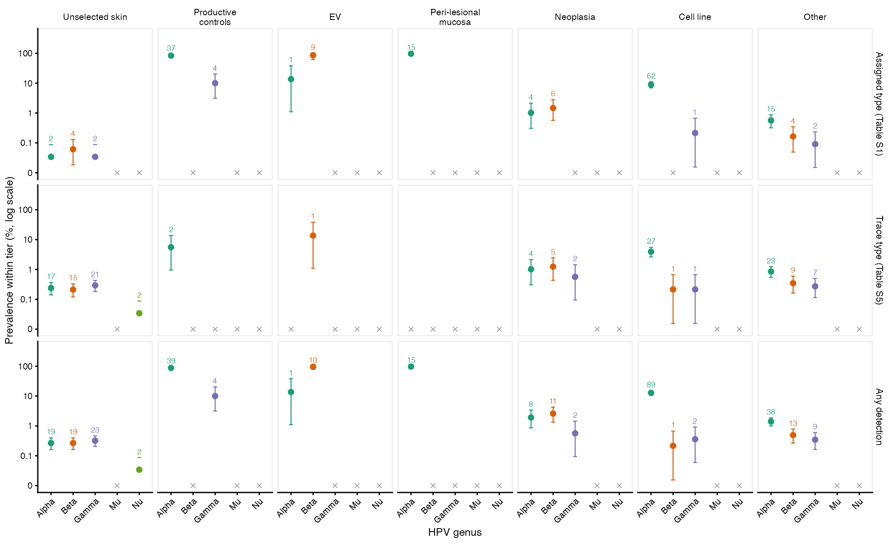
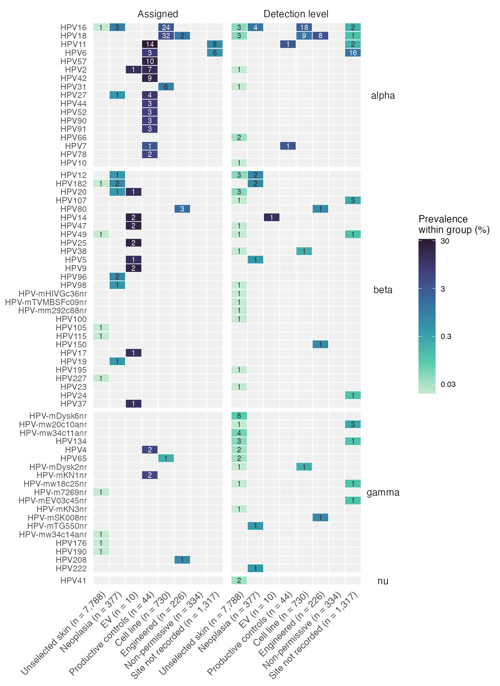
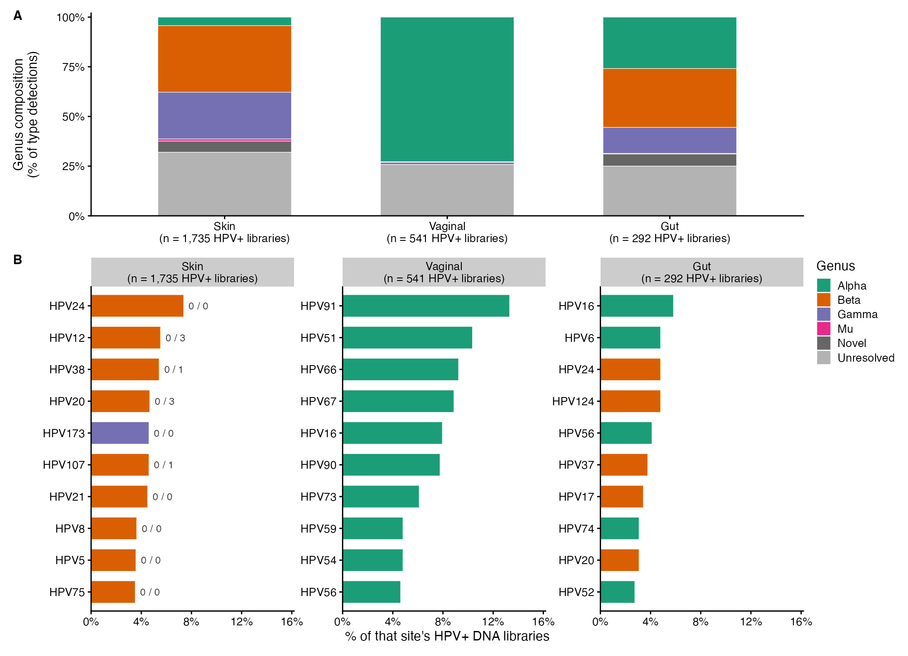
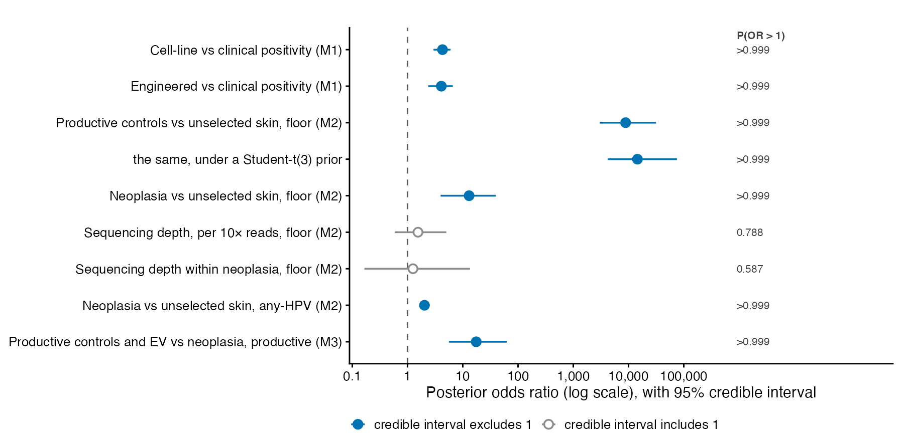
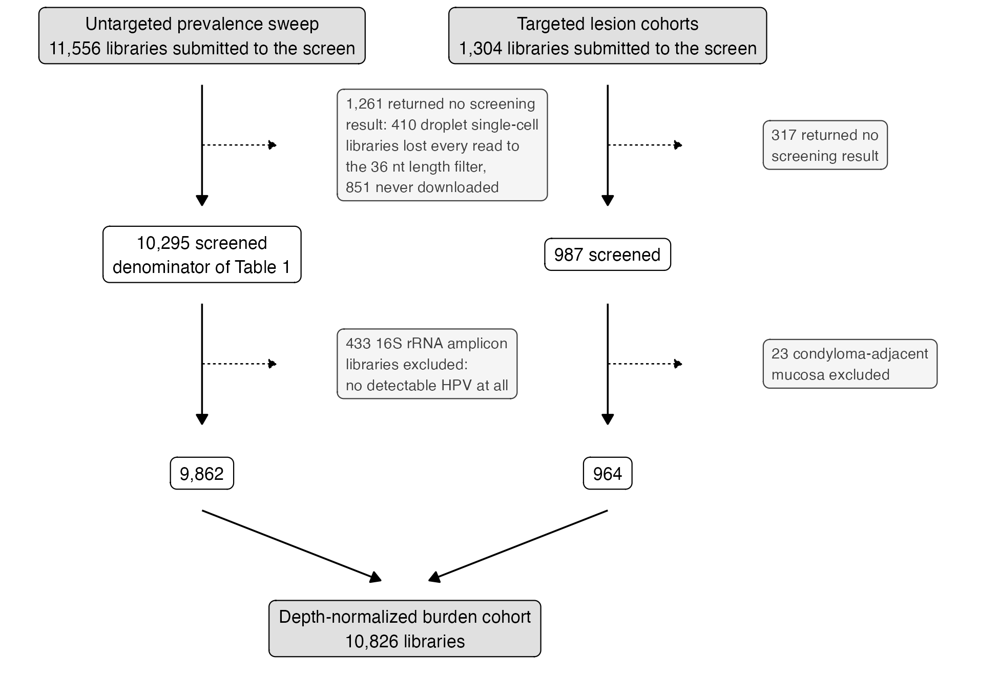

## Supplementary Figures and Tables {.unnumbered}

::: {#suppfig-depth}


Depth does not explain the group difference in @fig-rpm. For each sample group, the percentage of libraries reaching the control-calibrated detection floor (`r p1(stats$floor_rpm)` RPM) within five total-read bins (<5M, 5–10M, 10–20M, 20–40M, >40M reads). A group appears only in bins where it has at least three libraries; point size is proportional to that count. Productive controls (warts, condyloma) reach 90–100% in every bin they occupy, as do the EV biopsies in the deep bins where they fall. Cutaneous neoplasia (cSCC, actinic keratosis) and unselected skin stay near zero in every bin, including the deepest. The groups that reach the floor do so at any depth; those that do not never reach it, however deeply sequenced.
:::

::: {#suppfig-trace}


What the trace is made of. Every HPV-positive library below the control-calibrated detection floor (`r tr("floor")` RPM) in unselected skin and neoplasia (*n* = `r tr("trace_n")`), against the productive controls (warts and EV, *n* = `r tr("ctrl_n")`). Each library falls in exactly one of three classes, assigned in this order from the per-gene read counts the pipeline already writes: no reads on any HPV gene; gene-mapped reads below the productive threshold; productive (L1 ≥ 3 reads). Cell-line, engineered and site-unrecorded libraries are excluded, because the claim is about skin and neoplasia. Of the `r tr("trace_mid")` trace libraries that were gene-mapped but non-productive, `r tr("trace_mid_early")` carried early-gene reads without late reads and `r tr("trace_mid_lateonly")` carried only L2 reads below the productive threshold. The median late-read fraction was `r trn("trace_medlate")` in the trace libraries and `r trn("ctrl_medlate")` in the controls.
:::

::: {#suppfig-types}


The HPV type landscape, assigned catalog against detection level. @supptbl-types and @supptbl-detection as one grid. The two catalogs partition one cohort: a library either clears the assignment criterion (breadth ≥ 0.10, mean depth ≥ 2) and appears left, or resolves to a confident type below it and appears right, never both. Rows are HPV types, banded by genus and ordered by total libraries; columns are sample groups with their size on the axis. Each cell gives the library count, filled by that type's prevalence *within* the group (Beta-Binomial posterior mean, Beta(0.5, 0.5) prior) on a log~10~ scale from 0.02% to 91%. Group sizes span 10 to `r comma(stats$uns_n)` libraries, so 3 libraries is 32% of the EV group and 0.04% of unselected skin. Gray marks a type not seen in that group.
:::

::: {#suppfig-reservoir-gut}


The DNA reservoir across body sites, the positive control for the composition read-out. Skin (n = `r comma(rvn("n_skin_lib"))` HPV-positive libraries), vaginal (n = `r comma(rvn("n_vaginal_lib"))`) and gut (n = `r comma(rvn("n_gut_lib"))`) metagenomes, tabulated from the same catalog by the same code as @fig-reservoir. (**a**) Genus composition of each site's HPV-positive libraries. A library carrying types of two genera contributes to both, so the panel is normalized within site and shows the composition of type detections, not prevalence. *Unresolved* is a contig with a papillomavirus identity that cannot be placed in a genus, *Novel* a cluster with no reference match. (**b**) The ten most frequent types at each site; beside the skin bars are that type's assigned / detection-level detections among the `r comma(rvn("n_skin_rna"))` unselected-skin RNA libraries of this study, as in @fig-reservoir a. Vaginal metagenomes were dominated by alpha types, as expected for a mucosal site, which indicates that the tabulation recovers the known composition of a body site. Gut metagenomes contained both alpha (`r p1(rvn("gut_alpha"))`%) and beta (`r p1(rvn("gut_beta"))`%) types, a composition that is consistent with sampling across perianal skin. In agreement with this interpretation, the fraction of novel clusters in gut (`r p1(rvn("gut_novel_any"))`%) was closer to that in skin (`r p1(rvn("skin_novel_any"))`%) than to that in the vaginal site (`r p1(rvn("vaginal_novel_any"))`%).
:::

::: {#suppfig-bayes}


The Bayesian re-analysis as a forest plot. The posterior summaries of @supptbl-bayes on a log odds-ratio axis: each point is the posterior median odds ratio, each bar the 95% credible interval, and the dashed line at OR = 1 marks no effect. Filled points mark intervals that exclude 1. The two open gray points are the intervals that do not, and both are sequencing-depth terms, so deeper sequencing buys no productive-level detection either across sample groups or within neoplasia. P(OR > 1) is the posterior probability of a positive effect, rounded as in the text. Contrast labels and their order follow @supptbl-bayes, with one addition: the Student-*t*(3) prior-sensitivity refit, which @supptbl-bayes reports in its note, is drawn here beneath the contrast it refits.
:::

::: {#suppfig-cohort-flow}


How the two analysis populations are assembled, and where they part. Left, the untargeted prevalence sweep; right, the targeted lesion cohorts. Solid arrows carry libraries forward, dashed arrows show what leaves at each step. The two populations are not nested: they share one stage, the screened libraries, then diverge, because the depth-normalized burden analysis adds the lesion cohorts and removes two sets that neither a null nor a control describes. A library counts as screened when it returned a Kraken2 report; one that returned none is excluded from the positivity denominator of @tbl-positivity rather than counted as HPV-negative, because a library that was never screened is not a negative observation. Every count is computed by `manuscript/figure_cohort_flow.R` from the files the analysis scripts read.
:::

::: {#supptbl-types}
```{r}
#| echo: false
#| output: asis
cat(knitr::kable(build_type_table(), format = "pipe", align = c("l", rep("r", 6))), sep = "\n")
```

Each cell gives the library count and, in parentheses, the prevalence *within* that group: the count divided by the group size in the column header, as a Beta-Binomial posterior mean under a weakly-informative Beta(0.5, 0.5) prior. Group sizes span more than two orders of magnitude, so prevalence, not count, is what compares across groups. @suppfig-types draws this table together with @supptbl-detection as one grid, and @fig-genus summarizes both at the level of HPV genus. Unselected skin contributes no type above the two-library display threshold apart from two HPV18 calls, because its beta and gamma types fall below the assignment criterion and appear in @supptbl-detection.

**Number of libraries assigned to each HPV reference type across sample groups (types with ≥2 assigned libraries shown).**
:::

::: {#supptbl-productive}
```{r}
#| echo: false
#| output: asis
cat(knitr::kable(build_prod_table(), format = "pipe", align = c("l", "l", "l", "r", "r", "r")), sep = "\n")
```

Each library met the productive criterion (≥3 L1 major-capsid reads) and was flagged as primary tissue rather than cell line or engineered material. Coverage breadth is the maximum across assigned references for that sample. In the two site-unrecorded co-infections (ERR2274877, ERR1971044, both from cutaneous actinic-keratosis/cSCC cohorts) the co-infecting beta-type HPV182 reached 98–99% genome coverage at 243–245× mean depth. These cases show that bona fide productive cutaneous beta-HPV infection does occur in primary tissue, but against the population-scale null they are the exception (see main text and @fig-rpm).

**Genuine, non-cell-line productive HPV infections detected in primary skin and skin-associated tissue.**
:::

::: {#supptbl-bayes}
```{r}
#| echo: false
#| output: asis
cat(knitr::kable(build_bayes_table(stats, bget), format = "pipe", align = c("l", "l", "l", "r")), sep = "\n")
```

Each frequentist model (M1–M3; Methods, @tbl-positivity, @fig-rpm) was refitted as a Bayesian logistic regression with a Normal(0, 2.5) prior on the log-odds coefficients and a Normal(0, 5) prior on the intercept (`rstanarm`; four chains, all R-hat ≤ 1.004, no divergent transitions). Odds ratios are posterior medians with 95% credible intervals; P(OR > 1) is the posterior probability of a positive effect. Frequentist odds ratios (with *P* values) are shown for comparison; the productive-controls-versus-skin row is a Fisher exact estimate inflated by near-complete separation, whose Bayesian counterpart is regularized by the prior (a heavier-tailed Student-*t*(3) prior gives an even larger posterior OR, `r bor(bget("M2c_controls_vs_skin_floor_studentt"))`, confirming robustness). Sequencing depth is modeled per 10-fold (log₁₀) change in library size.

**Bayesian re-analysis of the principal contrasts under weakly-informative priors.**
:::

::: {#supptbl-cin}
```{r}
#| echo: false
#| output: asis
cat(knitr::kable(cin_tbl, format = "pipe", align = c("l", "l", "l", "l", "l", "r")), sep = "\n")
```

All `r nword(stats$cin_n)` are typed as the mucosal high-risk type HPV16 (dominant assigned reference) while carrying squamous-cell-carcinoma diagnoses at a cutaneous or unrecorded site, and all exceed the control-calibrated detection floor (`r p1(stats$floor_rpm)` RPM), so they make up `r stats$cin_n` of the `r stats$neo_pos_floor` above-floor detections in the whole group. Excluding these libraries reduced detection at or above the floor in neoplasia from `r pp(stats$neo_pctfloor)`% to `r pp(stats$neo_pctfloor_cut)`% (versus unselected skin: OR `r fo(stats$m2b_or_cut)`, *P* = `r fp(stats$m2b_p_cut)`, compared with OR `r fo(stats$m2b_or)` when they are retained) and changed the productivity contrast between productive controls and neoplasia from OR `r fo(stats$m3_or)` to OR `r fo(stats$m3_or_cut)` (*P* = `r fp(stats$m3_p_cut)`). Retaining them is therefore the conservative choice. The libraries of this set that carried enough viral reads for junction calling were integration-positive, whereas the other neoplasia libraries were not.

**High-risk mucosal HPV16 cases captured by the broadened cutaneous-neoplasia query and conservatively retained in the neoplasia group.**
:::

::: {#supptbl-chem}
```{r}
#| echo: false
#| output: asis
if (nrow(chem_tbl)) cat(knitr::kable(chem_tbl, format = "pipe", align = c("l", rep("r", 6))), sep = "\n")
```

Chemistry was called from SRA `LibrarySelection` where that field carries a specific value, and otherwise from the free-text library-construction protocol (Methods); `r pp(stats$chem_pct)`% of the `r comma(stats$chem_total)` libraries resolved, the remainder being records in which neither source states how the library was selected. After adjustment for depth and sample group, the amplification-based chemistries carried more any-HPV signal than poly-A libraries (template-switching, OR `r fo(stats$chem_smart_or)`; 3'-barcoded droplet libraries, OR `r fo(stats$chem_tenx_or)`). Among the `r comma(stats$ribo_n)` rRNA-depleted libraries alone, the any-HPV excess of neoplasia over unselected skin persisted (OR `r fo(stats$ribo_or)`, 95% CI `r oci(stats$ribo_lo, stats$ribo_hi)`, *P* = `r fp(stats$ribo_p)`).

**Library-selection chemistry by sample group, as a percentage of the libraries in each group (group size in parentheses).**
:::

::: {#supptbl-detection}
```{r}
#| echo: false
#| output: asis
cat(knitr::kable(build_detection_table(), format = "pipe", align = c("l","l","r","r","r","r","r","r")), sep = "\n")
```

This table is the complement of @supptbl-types, not an extension of it: it contains only the `r stats$detection_n` HPV-positive libraries that fell *below* the breadth ≥ 0.10 and depth ≥ 2 assignment threshold, so a library appears in exactly one of the two. For each eligible library the best-hit reference was taken from unique STAR primary alignments (MAPQ 255); `r stats$detection_resolved` resolved to a confident low-coverage type (at least 5 best-hit reads, MAPQ ≥ 20, and a majority of the library's primary alignments on that reference) spanning `r stats$detection_ntypes` types (those with ≥ 2 resolved calls shown), with genus from the complete PaVE lookup. As in @supptbl-types, each cell gives the count with its prevalence among *all* libraries of that group in parentheses (the estimator of @supptbl-types; group sizes in the headers), which keeps both tables on one denominator. The detection-eligible counts per group are `r detection_elig_str()`. @fig-genus collapses this table, and @supptbl-types, from HPV type to HPV genus. Of the `r stats$detection_skin_n` resolved calls in unselected skin, `r stats$detection_skin_cut` were cutaneous beta, gamma or nu types, whereas HPV16 was concentrated in cell lines (detection-level prevalence `r ciT("HPV16","cell_line")` in cell lines versus `r ciT("HPV16","unselected_skin")` in unselected skin). Productive controls are nearly absent from this table, because `r stats$ctrl_n - detection_elig("control_productive")` of the `r stats$ctrl_n` libraries were assigned a type in @supptbl-types.

**Detection-level HPV type catalog (@suppfig-types).**
:::

::: {#supptbl-coinf}
```{r}
#| echo: false
#| output: asis
cat(knitr::kable(build_coinf_table(), format = "pipe", align = c("l", "l", "l", "l")), sep = "\n")
```

Every library in which two or more references independently cleared the assignment criterion (coverage breadth ≥ 0.10 **and** mean depth ≥ 2) is listed, with each type's breadth and mean depth, ordered by depth. Of the `r cf$typed` typed libraries, `r cf$libs` qualify (`r cf$k2` with 2 types, `r cf$k3` with 3, `r cf$k4` with 4, `r cf$k5` with 5). Coverage is computed by `samtools coverage -q 10`, which retains only uniquely-mapped reads, and STAR assigns MAPQ ≤ 3 to any read placing equally well on two references, so cross-mapping between similar types cannot produce a co-infection call. The rows are not independent observations: `r cf$pair_libs` of the `r cf$libs` libraries come from two paired studies (SRP314958 and SRP314961) of condyloma lesions from `r cf$pair_donors` donors, each of which was sequenced as an RNA-seq library and as MeRIP input and IP fractions. In addition, the secondary types were often close to the assignment threshold (median depth `r p1(cf$sec_med_depth)`×; `r cf$sec_shallow`% below 5×), and the dominant type exceeded its partner by a median of `r fo(cf$dom_ratio_med)`-fold (interquartile range `r fo(cf$dom_ratio_lo)` to `r fo(cf$dom_ratio_hi)`).

**Libraries carrying more than one assigned HPV type.**
:::

::: {#supptbl-e2}
```{r}
#| echo: false
#| output: asis
cat(knitr::kable(build_e2_table(), format = "pipe",
                 align = c("l", "r", "r", "r", "r")), sep = "\n")
```

Contigs recovered from the Logan-wide papillomavirus catalog (Shen et al, 2026, eLife Reviewed Preprint) were annotated by `tblastn` against RefSeq papillomavirus open reading frames, and scored for whether E2 is present given that E1 is present. Across all contigs, E2 recovery followed assembly quality: it was lowest in cervical CIN (79.3%) and cervical carcinoma (83.6%), the categories with the shortest contigs. Among near-complete contigs (≥7 kb), E2 was present in nearly all contigs of every category, including cervical carcinoma (99.3%) and skin (99.9%). Because an integrated genome does not assemble across the virus-host junction, near-complete contigs represent episomal genomes, and the presence of E2 in assembled contigs therefore cannot indicate integration.

**E2 integrity in assembled papillomavirus contigs, and why it cannot detect integration.**
:::
