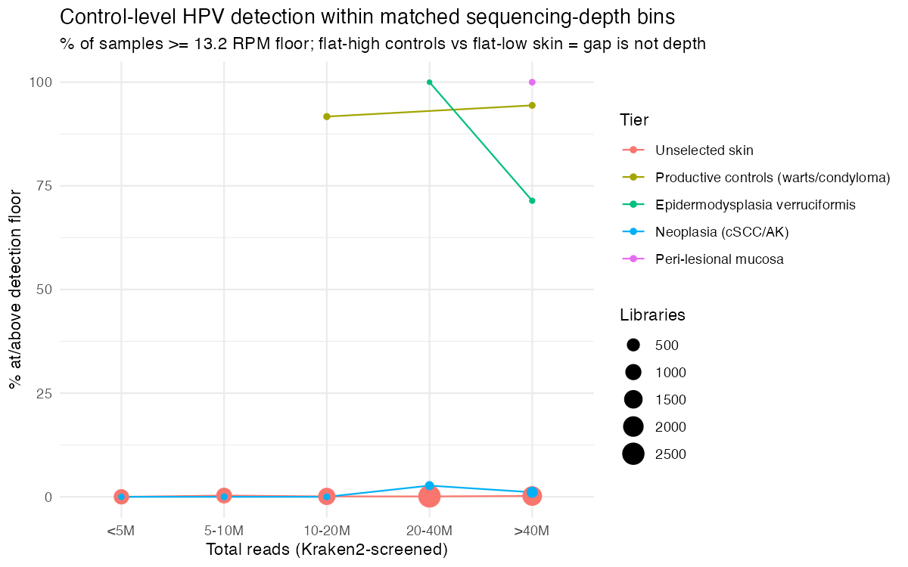
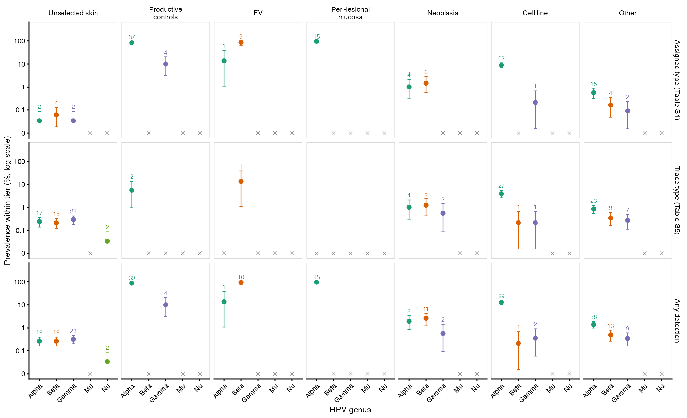

# Supplementary Material {.unnumbered}

::: {#suppfig-depth}


Control-level HPV detection within matched sequencing-depth bins. For each population tier, the percentage of libraries reaching the control-calibrated detection floor (`r p1(stats$floor_rpm)` RPM) is plotted within five total-read bins (<5M, 5–10M, 10–20M, 20–40M, >40M reads); a tier is drawn in a bin only where it has at least three libraries. Productive controls (warts/condyloma) detect at 90–100% in every bin in which they occur, as do the EV biopsies and the peri-lesional mucosa in the deep bins where they fall, whereas cutaneous neoplasia (cSCC/actinic keratosis) and unselected skin stay near zero across all bins, including the deepest. This depth-matched comparison confirms that the tier difference in @fig-rpm is not produced by differences in sequencing depth: the tiers that reach the floor do so at every depth, and the tiers that do not never reach it, however deeply sequenced. Point size is proportional to the number of libraries in each tier × bin.
:::

::: {#supptbl-types}
```{r}
#| echo: false
#| output: asis
cat(knitr::kable(build_type_table(), format = "pipe", align = c("l", rep("r", 6))), sep = "\n")
```

Number of libraries assigned to each HPV reference type across population tiers (types with ≥2 assigned libraries shown). Each cell also gives, in parentheses, the prevalence *within* that tier, the library count divided by the tier size in the column header, estimated as a Beta-Binomial posterior mean under a weakly-informative Beta(0.5, 0.5) prior. Because tier sizes span more than two orders of magnitude, raw counts are not comparable across tiers: the 14 HPV11 detections in productive controls and the 14 in peri-lesional mucosa correspond to very different prevalences (`r ciA("HPV11","control_productive")` versus `r ciA("HPV11","peri_lesional")`; posterior mean with 95% credible interval), and the high-risk mucosal types HPV16 and HPV18 are confined almost entirely to cell-line material (`r ciA("HPV16","cell_line")` and `r ciA("HPV18","cell_line")` of cell-line libraries, versus below 0.1% of skin libraries for both), the signature of integrated-HPV cell-line contamination. Productive controls are dominated by cutaneous wart and low-risk types (HPV57, HPV2, HPV27, HPV6/11, HPV42); the EV tier by the beta-types that define the syndrome (HPV9, HPV14, HPV20, HPV25, HPV47); peri-lesional mucosa by the mucosal alpha repertoire of the adjacent condylomata (HPV11, HPV42, HPV6, HPV74, HPV90). The neoplasia-associated infections are the gamma- and alpha-types HPV12, HPV16, HPV96 and HPV182. Unselected skin contributes no type above the two-library display threshold apart from two HPV18 contamination calls: its beta/gamma reservoir lies below the breadth-and-depth assignment criterion and appears instead in @supptbl-trace. @fig-genus summarises this table, and @supptbl-trace, at the level of HPV genus.
:::

::: {#supptbl-productive}
```{r}
#| echo: false
#| output: asis
cat(knitr::kable(build_prod_table(), format = "pipe", align = c("l", "l", "l", "r", "r", "r")), sep = "\n")
```

Genuine, non-cell-line productive HPV infections detected in primary skin and skin-associated tissue. Each library met the productive criterion (≥3 L1 major-capsid reads) and was flagged as primary tissue rather than cell line or engineered material. Coverage breadth is the maximum across assigned references for that sample. In the two site-unrecorded co-infections (ERR2274877, ERR1971044, both from cutaneous actinic-keratosis/cSCC cohorts) the co-infecting gamma-type HPV182 reached 98–99% genome coverage at 243–245× mean depth. These cases show that bona fide productive cutaneous beta- and gamma-HPV infection does occur in primary tissue, but against the population-scale null they are the exception (see main text and @fig-rpm).
:::

::: {#supptbl-bayes}
```{r}
#| echo: false
#| output: asis
cat(knitr::kable(build_bayes_table(stats, bget), format = "pipe", align = c("l", "l", "l", "r")), sep = "\n")
```

Bayesian re-analysis of the principal contrasts under weakly-informative priors. Each frequentist model (M1–M3; Methods, @tbl-positivity, @fig-rpm) was refitted as a Bayesian logistic regression with a Normal(0, 2.5) prior on the log-odds coefficients and a Normal(0, 5) prior on the intercept (`rstanarm`; four chains, all R-hat ≤ 1.004, no divergent transitions). Odds ratios are posterior medians with 95% credible intervals; P(OR > 1) is the posterior probability of a positive effect. Frequentist odds ratios (with *P* values) are shown for comparison; the productive-controls-versus-skin row is a Fisher exact estimate inflated by near-complete separation, whose Bayesian counterpart is regularised by the prior (a heavier-tailed Student-*t*(3) prior gives an even larger posterior OR, `r bor(bget("M2c_controls_vs_skin_floor_studentt"))`, confirming robustness). Sequencing depth is modelled per 10-fold (log₁₀) change in library size.
:::

::: {#supptbl-cin}
```{r}
#| echo: false
#| output: asis
cat(knitr::kable(cin_tbl, format = "pipe", align = c("l", "l", "l", "l", "l", "r")), sep = "\n")
```

High-risk mucosal HPV16 cases captured by the broadened cutaneous-neoplasia query and conservatively retained in the neoplasia tier. All `r stats$cin_n` are typed as the mucosal high-risk type HPV16 (dominant assigned reference) while carrying squamous-cell-carcinoma diagnoses at a cutaneous or unrecorded site, and all exceed the control-calibrated detection floor (`r p1(stats$floor_rpm)` RPM), so they make up `r stats$cin_n` of the `r stats$neo_pos_floor` above-floor detections in the whole tier. Excluding them halves cutaneous-neoplasia floor-level detection, from `r pp(stats$neo_pctfloor)`% to `r pp(stats$neo_pctfloor_cut)`% (versus unselected skin: OR `r fo(stats$m2b_or_cut)`, *P* = `r fp(stats$m2b_p_cut)`, down from OR `r fo(stats$m2b_or)`), and strengthens the warts/EV-versus-neoplasia productivity contrast from OR `r fo(stats$m3_or)` to OR `r fo(stats$m3_or_cut)` (*P* = `r fp(stats$m3_p_cut)`). Retaining them is therefore the conservative analytical choice: the small floor-level excess of neoplasia over skin reported in the main text is an upper bound. Virus–host junction calling supports the same reading from an independent direction: the members of this set that carry enough viral reads to test are integration-positive, whereas the cutaneous-neoplasia libraries outside it are not. Integration is the expected state of mucosal HPV16 in carcinoma and is not a property of the cutaneous reservoir, so the assignment of these libraries to a mucosal origin rests on genome state as well as on type.
:::

::: {#supptbl-chem}
```{r}
#| echo: false
#| output: asis
if (nrow(chem_tbl)) cat(knitr::kable(chem_tbl, format = "pipe", align = c("l", rep("r", 6))), sep = "\n")
```

Library-selection chemistry by population tier, as a percentage of the libraries in each tier (tier size in parentheses). Chemistry was called from SRA `LibrarySelection` where that field carries a specific value, and otherwise from the free-text library-construction protocol (Methods); `r pp(stats$chem_pct)`% of the `r comma(stats$chem_total)` libraries resolved, the remainder being records in which neither source states how the library was selected. The table exists because poly-A capture is the chemistry least favourable to viral-transcript recovery, so an unbalanced distribution of chemistry across tiers could in principle manufacture the productivity contrast reported in the main text. It does not: the imbalance runs the other way. The neoplasia tier, in which no productive infection is found, is rRNA-depleted in `r pp(stats$chem_neo_ribo)`% of libraries against `r pp(stats$chem_skin_ribo)`% of unselected skin, while the productive controls, in which productive infection is abundant, contain no rRNA-depleted libraries at all. The two selection chemistries are in any case indistinguishable in their yield of trace HPV reads once depth and tier are accounted for (rRNA-depleted versus poly-A, OR `r fo(stats$chem_ribo_or)`, 95% CI `r oci(stats$chem_ribo_lo, stats$chem_ribo_hi)`, *P* = `r fp(stats$chem_ribo_p)`); the levels that do carry more trace signal are the amplification chemistries, template-switching (OR `r fo(stats$chem_smart_or)`) and 3'-barcoded droplet libraries (OR `r fo(stats$chem_tenx_or)`), which is the profile of amplification and barcode-swapping artefact rather than of recovery. Restricting the skin-versus-neoplasia contrast to the `r comma(stats$ribo_n)` rRNA-depleted libraries alone leaves the trace excess intact (OR `r fo(stats$ribo_or)`, `r oci(stats$ribo_lo, stats$ribo_hi)`, *P* = `r fp(stats$ribo_p)`) and yields no above-floor library in either tier.
:::

::: {#supptbl-trace}
```{r}
#| echo: false
#| output: asis
cat(knitr::kable(build_trace_table(), format = "pipe", align = c("l","l","r","r","r","r","r","r")), sep = "\n")
```

Detection-tier HPV type catalogue. This table is the complement of @supptbl-types, not an extension of it: it contains only the `r stats$trace_n` HPV-positive libraries that fell *below* the breadth ≥ 0.10 and depth ≥ 2 assignment threshold and therefore have no entry in @supptbl-types. A library appears in exactly one of the two tables. That is why tiers dominated by high-coverage infection are nearly empty here: of the `r stats$ctrl_n` productive-control libraries, `r stats$ctrl_n - trace_elig("control_productive")` are assigned a type in @supptbl-types and only `r trace_elig("control_productive")` remain eligible for this table, of which `r stats$trace_ctrl_resolved` resolve; the peri-lesional tier contributes none at all. The near-absence of productive controls from the detection tier is a positive control on the assignment criterion, not a missing signal. For each eligible library the best-hit reference was taken from unique STAR primary alignments (MAPQ 255); `r stats$trace_resolved` resolved to a confident low-coverage type spanning `r stats$trace_ntypes` types (those with ≥ 2 resolved calls shown), with genus from the complete PaVE lookup. These are low-coverage, non-productive detections: the type is confidently identified but genome coverage is below the assignment breadth, so they extend the descriptive type catalogue without bearing on productivity. As in @supptbl-types, each cell gives the count with its prevalence among *all* libraries of that tier in parentheses (Beta-Binomial posterior mean, Beta(0.5, 0.5) prior; tier sizes in the headers), keeping both tables on one denominator; the trace-eligible counts per tier are `r trace_elig_str()`. Healthy skin is dominated by cutaneous beta/gamma/nu types (`r stats$trace_skin_cut` of `r stats$trace_skin_n` resolved skin calls), whereas the mucosal types HPV16 and HPV18 concentrate in cell-line and other material (HPV16 trace prevalence `r ciT("HPV16","cell_line")` in cell lines versus `r ciT("HPV16","unselected_skin")` in skin), reproducing the contamination pattern of @supptbl-types at the sensitivity floor. @fig-genus collapses this table, and @supptbl-types, from HPV type to HPV genus.
:::


::: {#suppfig-types}


The HPV type landscape, assigned catalogue against detection tier. The same data as @supptbl-types and @supptbl-trace, laid out as one grid because the two tables partition a single cohort: a library either clears the assignment criterion (coverage breadth ≥ 0.10 **and** mean depth ≥ 2) and appears in the upper panel, or resolves to a confident type below it and appears in the lower panel, never both. Columns are HPV types grouped by genus and ordered within each genus by total libraries; rows are population tiers, with each tier's size on the axis. Fill is the prevalence of that type *within* that tier, as a Beta-Binomial posterior mean under a Beta(0.5, 0.5) prior, the same estimator the tables use; the number printed in each cell is the raw library count. Prevalence rather than count is what the colour encodes because tier sizes span 10 to `r comma(stats$uns_n)` libraries, so counts are not comparable across rows: three libraries is 23% of the EV tier and 0.04% of unselected skin. The scale is log~10~ for the same reason, spanning 0.02% to 91%, and grey marks a type not seen in that tier at all. Read that way the two panels say different things. The assigned catalogue is concentrated in three rows, productive controls, peri-lesional mucosa and cell lines, and almost entirely in the alpha block, which is the productive-lesion signal and the contamination signal respectively. The unselected-skin row is pale in both panels, and that is the finding rather than an absence: no single cutaneous type is common in healthy skin, but in the detection panel that row runs almost the full width of the beta and gamma blocks, each type carried by a handful of libraries. A commensal reservoir is diverse and individually rare, and it is visible here as the length of that row rather than the intensity of any cell in it. Those same types are largely missing from the assigned panel, because they sit below the coverage threshold a type assignment requires, not because they are absent. @fig-genus collapses both panels from type to genus.
:::

::: {#supptbl-coinf}
```{r}
#| echo: false
#| output: asis
cat(knitr::kable(build_coinf_table(), format = "pipe", align = c("l", "l", "l", "l")), sep = "\n")
```

Libraries carrying more than one assigned HPV type. Every library in which two or more references independently cleared the assignment criterion (coverage breadth ≥ 0.10 **and** mean depth ≥ 2) is listed, with each type's breadth and mean depth, ordered by depth; `r cf$libs` of the `r cf$typed` typed libraries qualify (`r cf$k2` with two types, `r cf$k3` with three, `r cf$k4` with four, `r cf$k5` with five). Coverage is computed by `samtools coverage -q 10`, which retains only uniquely-mapped reads, since STAR assigns MAPQ ≤ 3 to any read placing equally well on two references, so cross-mapping between similar types cannot manufacture a co-infection call: each type in a row is supported by reads that map to it and to nothing else. Three cautions govern how far the table can be read. First, the rows are not independent observations: `r cf$pair_libs` of the `r cf$libs` come from the paired studies SRP314958 (RNA-seq) and SRP314961 (MeRIP-seq), which are the same `r cf$pair_donors` donors, five condyloma lesions (CA_1 to CA_5) and four matched peri-lesional specimens (CON_1 to CON_4), each sequenced as an RNA-seq library plus a MeRIP input and IP fraction, so rows sharing a donor carry near-identical read profiles. Second, the secondary types often sit close to the threshold: across all non-dominant calls the median depth is `r p1(cf$sec_med_depth)`× and `r cf$sec_shallow`% fall below 5×, so which type is called second can depend on the library fraction, and in donor CA_2 the RNA-seq and MeRIP input fractions call HPV6 + HPV11 while the IP fraction of the same specimen calls HPV6 + HPV42. Third, the deepest type in a co-infected library typically dominates its partner, by a median of `r fo(cf$dom_ratio_med)`-fold (interquartile range `r fo(cf$dom_ratio_lo)` to `r fo(cf$dom_ratio_hi)`), so most rows describe one established infection alongside a minor second type rather than two comparable ones. Where both partners are unambiguous the pairings are biologically coherent: two carcinoma and actinic-keratosis libraries whose SRA records carry no tissue field (ERR2274877, ERR1971044) carry the gamma-types HPV96 and HPV182 together at 98–99% breadth and 61–245× depth, and an EV biopsy (SRR21205038) carries the beta-types HPV20 and HPV9 at 18,558× and 736×; both are two full genomes in one library, not a genome plus a fragment. The most frequent pairing in the study is HPV11 with HPV42: `r cf$both1142` libraries carry both, `r cf$only11` carry HPV11 without HPV42, and only `r cf$only42` carry HPV42 without HPV11; in the peri-lesional tier the association is forced by the marginals of @supptbl-types, where 14 HPV11 and 13 HPV42 calls are distributed over 15 libraries. Requiring both partners to clear a stricter bar (breadth ≥ 0.70 and depth ≥ 5× for each) leaves `r cf$strict_libs` libraries from `r cf$strict_donors` donors: one condyloma lesion (CA_1) and two peri-lesional specimens (CON_1, CON_3). Their dominance relation is asymmetric but not cleanly so. HPV11 is the deeper type in all five condyloma lesions, exceeding HPV42 48- to 4,100-fold in the three with a strong HPV11 signal (CA_1, CA_4, CA_5) and 2- to 4-fold in the other two; in peri-lesional mucosa HPV42 is the deeper type in CON_1 and CON_3, the two specimens where it is unambiguous (955× versus 138×, and 3,816× versus 9×, i.e. 7-fold and 410-fold), whereas in CON_2, CON_4 and CON_5, where HPV42 barely clears the assignment threshold, HPV11 remains the deeper type. Whether that reflects a genuine tissue difference in which type predominates, or merely that HPV42 clears the threshold only where it happens to be abundant, cannot be settled from three donors of one study: it is a hypothesis the data motivate, not a result they support.
:::

## Above-floor HPV in tissue that cannot host it: two contaminated studies {#sec-s-crosstalk}

The non-permissive tissue tier is defined by biology, not by its HPV content, so
it also exposes the opposite case: libraries from non-permissive material that
carry HPV *above* the trace level. Two studies do, and both were held out of the
control tier for that reason.

SRP572742 (skeletal muscle and blood from myotonic dystrophy patients,
*n* = 66) is HPV-positive at any level in 83% of libraries, with 3 crossing the
control-calibrated detection floor and a maximum of 5.3 RPM. Neither muscle nor
blood contains stratified squamous epithelium, so no part of that signal can be
infection of the sampled tissue.

SRP565659 makes the point under internal control. It is a multi-omic
cutaneous T-cell lymphoma study in which skin and peripheral blood were taken
from the same patients and sequenced together (Table S1 of the source
publication assigns every run a tissue). Its 26 skin libraries are strongly
HPV-positive, 88% at any level and up to 12.0 RPM, as expected for lesional
skin. Its 42 blood and lymph-node libraries (same patients, same runs, tissue
that cannot host the virus) are HPV-positive at 52%, up to 3.6 RPM, with one
library above the floor.

The pattern in both is a minority of reads appearing in libraries with no
biological source for them, alongside co-sequenced libraries carrying a genuine
high-titre signal. That is the signature of index hopping and inter-library
carry-over rather than infection, and it is the same phenomenon that makes
cell-line contamination the dominant driver of apparent HPV positivity in public
transcriptomes. Two consequences follow for how the trace signal should be read. First,
a non-zero HPV read count in a single library is not evidence of infection even
when the tissue is plausible, which is why the analysis here is anchored on a
control-calibrated floor rather than on detection. Second, studies whose design
places high-titre and HPV-free material in the same sequencing run will inflate
apparent prevalence in the HPV-free arm, so prevalence estimates drawn from
public data without a non-permissive control are upper bounds.

::: {#supptbl-e2}
```{r}
#| echo: false
#| output: asis
cat(knitr::kable(build_e2_table(), format = "pipe",
                 align = c("l", "r", "r", "r", "r")), sep = "\n")
```

E2 integrity in assembled papillomavirus contigs, and why it cannot detect integration. Contigs recovered from the Logan-wide papillomavirus catalogue [@shenpv2026] were annotated by `tblastn` against RefSeq papillomavirus open reading frames, and scored for whether E2 is present given that E1 is present. The comparison that matters is between the two right-hand columns and the two left-hand ones. Across all contigs, E2 recovery tracks assembly quality rather than biology: it is lowest in cervical CIN (79.3%) and cervical carcinoma (83.6%), which are also the arms with the shortest contigs, and highest in the vaginal and gut metagenomes, which assemble best. Once the question is restricted to near-complete contigs (≥7 kb), where E2 presence can actually be assessed, every category converges on 100%, and cervical carcinoma, in which integration and E2 disruption are the rule, returns 99.3% against 99.9% for skin. That convergence is not a biological result. An integrated genome cannot assemble across the virus-host junction, so conditioning on completeness selects episomal genomes in every category, and the statistic is structurally incapable of detecting the event it was built to detect. This table is reported because the inference is an inviting one to draw from a public contig catalogue, and because it bounds what the DNA axis can contribute: presence of a papillomavirus in such a catalogue is presence of a detectable L1, and carries no information about the state of the genome (Discussion).
:::
