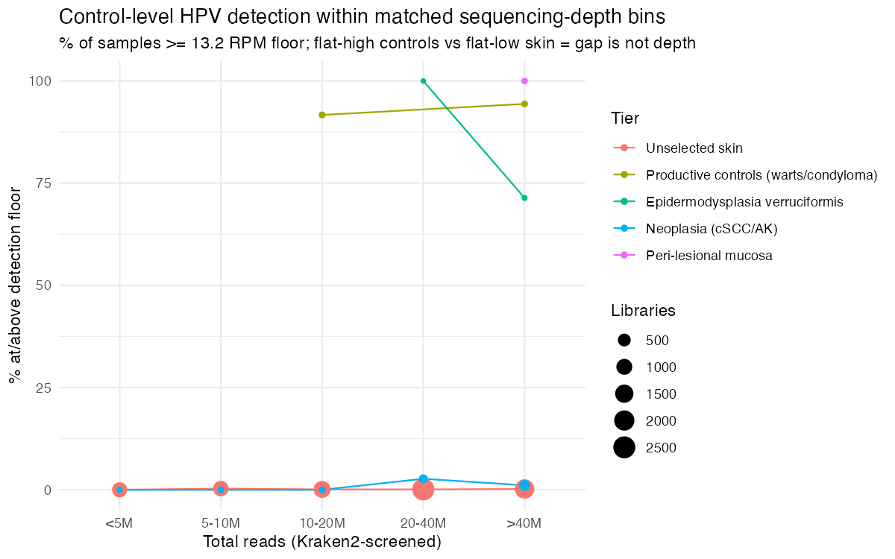
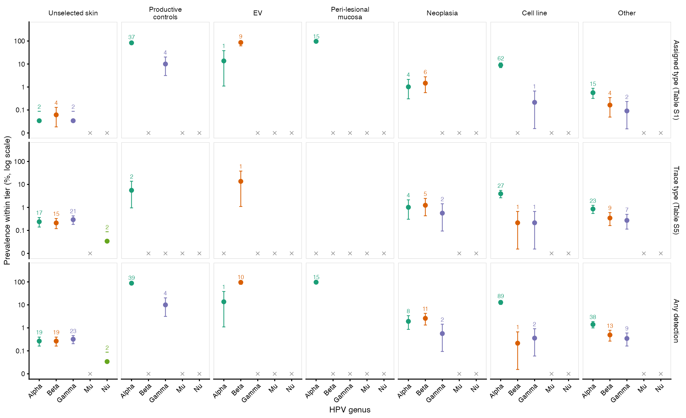
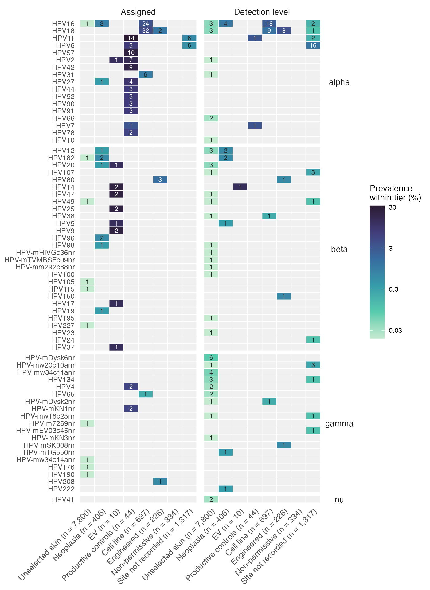
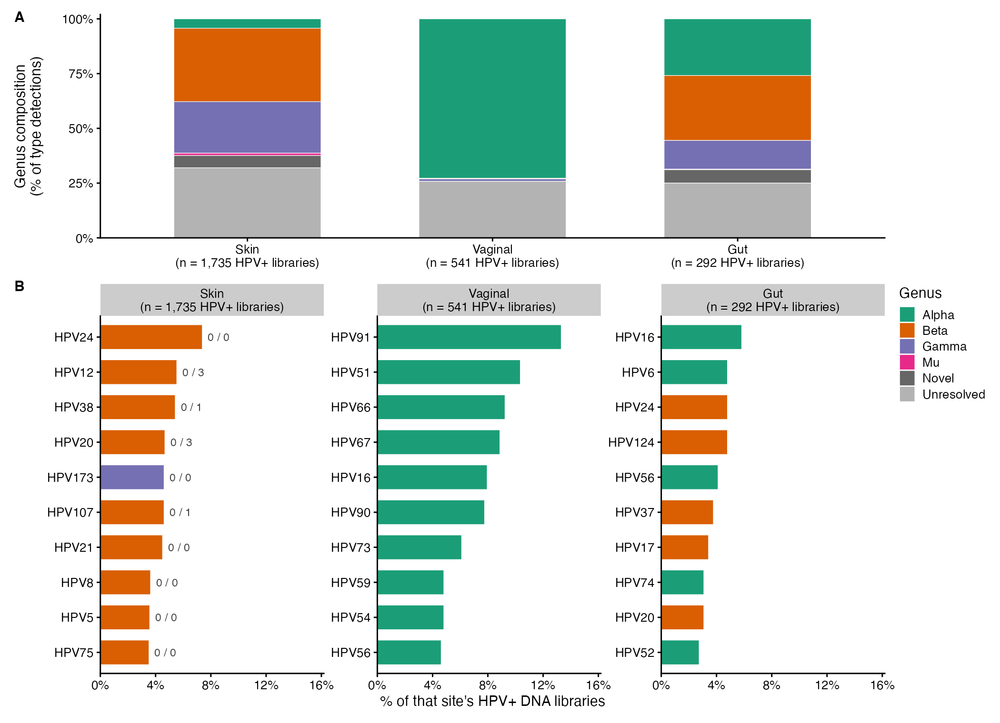
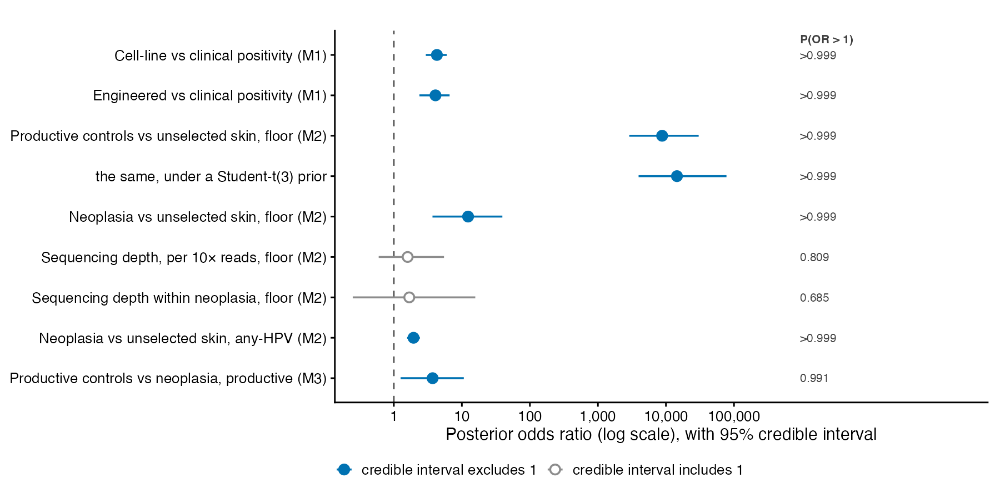
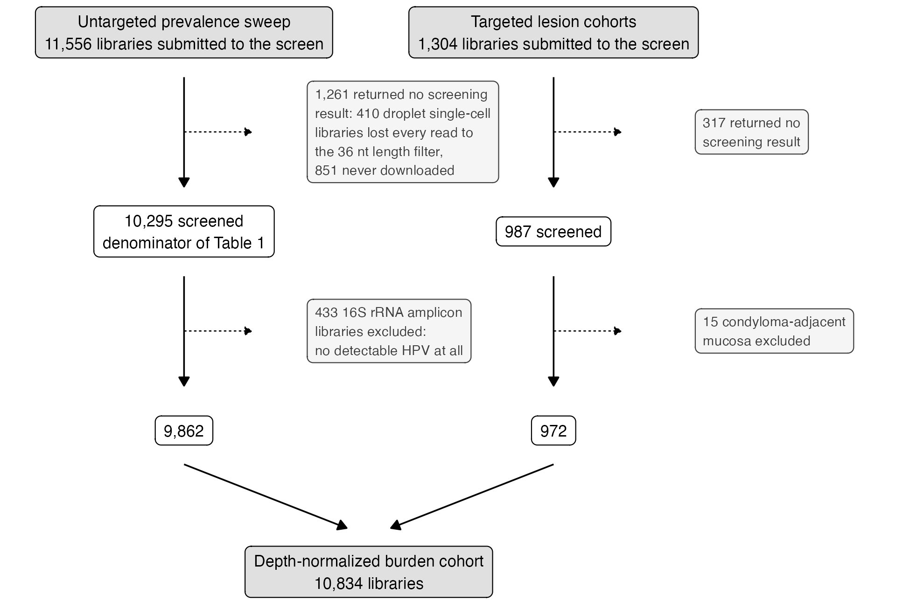

## Supplementary Figures and Tables {.unnumbered}

::: {#suppfig-depth}


Depth does not explain the group difference in @fig-rpm. For each sample group, the percentage of libraries reaching the control-calibrated detection floor (`r p1(stats$floor_rpm)` RPM) within five total-read bins (<5M, 5–10M, 10–20M, 20–40M, >40M reads). A group appears only in bins where it has at least three libraries; point size is proportional to that count. Productive controls (warts, condyloma) reach 90–100% in every bin they occupy, as do the EV biopsies in the deep bins where they fall. Cutaneous neoplasia (cSCC, actinic keratosis) and unselected skin stay near zero in every bin, including the deepest. The groups that reach the floor do so at any depth; those that do not never reach it, however deeply sequenced.
:::

::: {#suppfig-trace}


What the sub-threshold trace is made of. Every HPV-positive library below the control-calibrated detection floor (`r tr("floor")` RPM) in unselected skin and neoplasia (*n* = `r tr("trace_n")`), against the productive controls (warts and EV, *n* = `r tr("ctrl_n")`). Each library falls in exactly one of three classes, assigned in this order from the per-gene read counts the pipeline already writes: no reads on any HPV gene; gene-mapped reads below the productive threshold; productive (L1 ≥ 3 reads). Cell-line, engineered and site-unrecorded libraries are excluded, because the claim is about skin and neoplasia.
:::

### What the gene-level split shows

Of the `r tr("trace_n")` below-floor libraries in @suppfig-trace, the `r tr("trace_mid")` that are gene-mapped but non-productive split further: `r tr("trace_mid_early")` carry early-gene reads with the late program absent and `r tr("trace_mid_lateonly")` carry only L2 reads below the productive bar. The median late-read fraction across the trace is `r trn("trace_medlate")`, against `r trn("ctrl_medlate")` in the controls: the differentiation-coupled capsid program the controls demonstrate.

::: {#suppfig-types}


The HPV type landscape, assigned catalog against detection level. The catalogs of @supptbl-types and @supptbl-detection as one grid: they partition one cohort, so a library either clears the assignment criterion (breadth ≥ 0.10, mean depth ≥ 2) and appears left, or resolves to a confident type below it and appears right, never both. Rows are HPV types, banded by genus and ordered within genus by total libraries; columns are sample groups with their size on the axis. Each cell gives the library count, filled by that type's prevalence *within* the group (Beta-Binomial posterior mean, Beta(0.5, 0.5) prior) on a log~10~ scale from 0.02% to 91%, because group sizes span 10 to `r comma(stats$uns_n)` libraries: three libraries is 32% of the EV group, 0.04% of unselected skin. Gray marks a type not seen in that group.
:::

::: {#suppfig-reservoir-gut}


The DNA reservoir across body sites, the positive control for the composition read-out. Skin (n = `r comma(rvn("n_skin_lib"))` HPV-positive libraries), vaginal (n = `r comma(rvn("n_vaginal_lib"))`) and gut (n = `r comma(rvn("n_gut_lib"))`) metagenomes, tabulated from the same catalog by the same code as @fig-reservoir. (**a**) Genus composition of each site's HPV-positive libraries. A library carrying types of two genera contributes to both, so the panel is normalized within site and shows the composition of type detections, not prevalence. *Unresolved* is a contig with a papillomavirus identity that cannot be placed in a genus, *Novel* a cluster with no reference match. (**b**) The ten most frequent types at each site; beside the skin bars are that type's assigned / detection-level detections among the `r comma(rvn("n_skin_rna"))` unselected-skin RNA libraries of this study, as in @fig-reservoir a.
:::

### What the vaginal and gut sites establish

@suppfig-reservoir-gut is the positive control for the composition read-out: the same procedure applied to vaginal libraries recovers an overwhelmingly alpha mucosal niche, which assembly noise could not produce, so the skin composition in @fig-reservoir can be read as biology. Only skin is carried into the main figure, since the paper's subject is skin. The gut site mixes mucosal alpha (`r p1(rvn("gut_alpha"))`%) with cutaneous beta (`r p1(rvn("gut_beta"))`%), and its commonest types interleave the two (HPV16, HPV6 and HPV56 with HPV24, HPV124 and HPV37). That is the signature of a collection route crossing perianal skin rather than of papillomavirus carriage in the gut, and rectal-swab cohorts show the same pattern independently. So the gut is a useful control too: the catalog recovers the genus of whatever epithelium the sampling route touches. Its novel-cluster fraction (`r p1(rvn("gut_novel_any"))`%) sits with skin's (`r p1(rvn("skin_novel_any"))`%) rather than the vaginal site's (`r p1(rvn("vaginal_novel_any"))`%), as expected if its beta/gamma content is cutaneous in origin.

::: {#suppfig-bayes}


The Bayesian re-analysis as a forest plot. The posterior summaries of @supptbl-bayes on a log odds-ratio axis: each point is the posterior median odds ratio, each bar the 95% credible interval, and the dashed line at OR = 1 marks no effect. Filled points mark intervals that exclude 1. The two open gray points are the intervals that do not, and both are sequencing-depth terms, so deeper sequencing buys no productive-level detection either across sample groups or within neoplasia. P(OR > 1) is the posterior probability of a positive effect, rounded as in the text. Contrast labels and their order follow @supptbl-bayes, with one addition: the Student-*t*(3) prior-sensitivity refit, which @supptbl-bayes reports in its note, is drawn here beneath the contrast it refits.
:::

::: {#suppfig-cohort-flow}


How the two analysis populations are assembled, and where they part. Left, the untargeted prevalence sweep; right, the targeted lesion cohorts. Solid arrows carry libraries forward, dashed arrows show what leaves at each step. The two populations are not nested: they share one stage, the screened libraries, then diverge, because the depth-normalized burden analysis adds the lesion cohorts and removes two sets that neither a null nor a control describes. A library counts as screened when it returned a Kraken2 report; one that returned none is excluded from the positivity denominator of @tbl-positivity rather than counted as HPV-negative, because a library that was never screened is not a negative observation. Every count is computed by `manuscript/figure_cohort_flow.R` from the files the analysis scripts read, so the figure cannot disagree with the text.
:::

::: {#supptbl-types}
```{r}
#| echo: false
#| output: asis
cat(knitr::kable(build_type_table(), format = "pipe", align = c("l", rep("r", 6))), sep = "\n")
```

Each cell gives the library count and, in parentheses, the prevalence *within* that group: the count divided by the group size in the column header, as a Beta-Binomial posterior mean under a weakly-informative Beta(0.5, 0.5) prior. Group sizes span more than two orders of magnitude, so prevalence, not count, is what compares across groups. @suppfig-types draws this table together with @supptbl-detection as one grid, and @fig-genus summarizes both at the level of HPV genus.

**Number of libraries assigned to each HPV reference type across sample groups (types with ≥2 assigned libraries shown).**
:::

### What the assigned-type catalog shows

Raw counts are not comparable across groups: the 14 HPV11 detections in productive controls represent a far higher prevalence than the 24 HPV16 detections in the much larger cell-line group (`r ciA("HPV11","control_productive")` versus `r ciA("HPV16","cell_line")`; posterior mean with 95% credible interval). The high-risk mucosal types HPV16 and HPV18 are confined almost entirely to cell-line material (`r ciA("HPV16","cell_line")` and `r ciA("HPV18","cell_line")` of cell-line libraries, versus below 0.1% of skin libraries for both), the signature of integrated-HPV cell-line contamination. Productive controls are dominated by cutaneous wart and low-risk types (HPV57, HPV2, HPV27, HPV6/11, HPV42) and the EV group by the beta-types that define the syndrome (HPV9, HPV14, HPV20, HPV25, HPV47), while the neoplasia-associated infections are the beta- and alpha-types HPV12, HPV16, HPV96 and HPV182. Unselected skin contributes no type above the two-library display threshold apart from two HPV18 contamination calls: its beta/gamma reservoir lies below the breadth-and-depth assignment criterion and appears instead in @supptbl-detection.

::: {#supptbl-productive}
```{r}
#| echo: false
#| output: asis
cat(knitr::kable(build_prod_table(), format = "pipe", align = c("l", "l", "l", "r", "r", "r")), sep = "\n")
```

Each library met the productive criterion (≥3 L1 major-capsid reads) and was flagged as primary tissue rather than cell line or engineered material. Coverage breadth is the maximum across assigned references for that sample. In the two site-unrecorded co-infections (ERR2274877, ERR1971044, both from cutaneous actinic-keratosis/cSCC cohorts) the co-infecting beta-type HPV182 reached 98–99% genome coverage at 243–245× mean depth. These cases show that bona fide productive cutaneous beta-HPV infection does occur in primary tissue, but against the population-scale null they are the exception (see main text and @fig-rpm).

**Genuine, non-cell-line productive HPV infections detected in primary skin and skin-associated tissue.**
:::

::: {#supptbl-bayes}
```{r}
#| echo: false
#| output: asis
cat(knitr::kable(build_bayes_table(stats, bget), format = "pipe", align = c("l", "l", "l", "r")), sep = "\n")
```

Each frequentist model (M1–M3; Methods, @tbl-positivity, @fig-rpm) was refitted as a Bayesian logistic regression with a Normal(0, 2.5) prior on the log-odds coefficients and a Normal(0, 5) prior on the intercept (`rstanarm`; four chains, all R-hat ≤ 1.004, no divergent transitions). Odds ratios are posterior medians with 95% credible intervals; P(OR > 1) is the posterior probability of a positive effect. Frequentist odds ratios (with *P* values) are shown for comparison; the productive-controls-versus-skin row is a Fisher exact estimate inflated by near-complete separation, whose Bayesian counterpart is regularized by the prior (a heavier-tailed Student-*t*(3) prior gives an even larger posterior OR, `r bor(bget("M2c_controls_vs_skin_floor_studentt"))`, confirming robustness). Sequencing depth is modeled per 10-fold (log₁₀) change in library size.

**Bayesian re-analysis of the principal contrasts under weakly-informative priors.**
:::

::: {#supptbl-cin}
```{r}
#| echo: false
#| output: asis
cat(knitr::kable(cin_tbl, format = "pipe", align = c("l", "l", "l", "l", "l", "r")), sep = "\n")
```

All `r stats$cin_n` are typed as the mucosal high-risk type HPV16 (dominant assigned reference) while carrying squamous-cell-carcinoma diagnoses at a cutaneous or unrecorded site, and all exceed the control-calibrated detection floor (`r p1(stats$floor_rpm)` RPM), so they make up `r stats$cin_n` of the `r stats$neo_pos_floor` above-floor detections in the whole group.

**High-risk mucosal HPV16 cases captured by the broadened cutaneous-neoplasia query and conservatively retained in the neoplasia group.**
:::

### Why the mucosal HPV16 cases are retained

Excluding them halves cutaneous-neoplasia floor-level detection, from `r pp(stats$neo_pctfloor)`% to `r pp(stats$neo_pctfloor_cut)`% (versus unselected skin: OR `r fo(stats$m2b_or_cut)`, *P* = `r fp(stats$m2b_p_cut)`, down from OR `r fo(stats$m2b_or)`), and strengthens the warts/EV-versus-neoplasia productivity contrast from OR `r fo(stats$m3_or)` to OR `r fo(stats$m3_or_cut)` (*P* = `r fp(stats$m3_p_cut)`). Retaining them is therefore the conservative analytical choice: the small floor-level excess of neoplasia over skin reported in the main text is an upper bound. Virus-host junction calling supports the same reading from an independent direction: the members of this set that carry enough viral reads to test are integration-positive, whereas the cutaneous-neoplasia libraries outside it are not. Integration is the expected state of mucosal HPV16 in carcinoma and is not a property of the cutaneous reservoir, so the assignment of these libraries to a mucosal origin rests on genome state as well as on type.

::: {#supptbl-chem}
```{r}
#| echo: false
#| output: asis
if (nrow(chem_tbl)) cat(knitr::kable(chem_tbl, format = "pipe", align = c("l", rep("r", 6))), sep = "\n")
```

Chemistry was called from SRA `LibrarySelection` where that field carries a specific value, and otherwise from the free-text library-construction protocol (Methods); `r pp(stats$chem_pct)`% of the `r comma(stats$chem_total)` libraries resolved, the remainder being records in which neither source states how the library was selected.

**Library-selection chemistry by sample group, as a percentage of the libraries in each group (group size in parentheses).**
:::

### Library chemistry does not manufacture the productivity contrast

Poly-A capture is the chemistry least favorable to viral-transcript recovery, so an unbalanced distribution of chemistry across groups could in principle manufacture the productivity contrast reported in the main text. It does not: the imbalance runs the other way. The neoplasia group, in which no productive infection is found, is rRNA-depleted in `r pp(stats$chem_neo_ribo)`% of libraries against `r pp(stats$chem_skin_ribo)`% of unselected skin, while the productive controls, in which productive infection is abundant, contain no rRNA-depleted libraries at all. The two selection chemistries are in any case indistinguishable in their yield of any-HPV reads once depth and group are accounted for (rRNA-depleted versus poly-A, OR `r fo(stats$chem_ribo_or)`, 95% CI `r oci(stats$chem_ribo_lo, stats$chem_ribo_hi)`, *P* = `r fp(stats$chem_ribo_p)`). The levels that do carry more any-HPV signal are the amplification chemistries, template-switching (OR `r fo(stats$chem_smart_or)`) and 3'-barcoded droplet libraries (OR `r fo(stats$chem_tenx_or)`), which is the profile of amplification and barcode-swapping artifact rather than of recovery. Restricting the skin-versus-neoplasia contrast to the `r comma(stats$ribo_n)` rRNA-depleted libraries alone leaves the any-HPV excess intact (OR `r fo(stats$ribo_or)`, `r oci(stats$ribo_lo, stats$ribo_hi)`, *P* = `r fp(stats$ribo_p)`) and yields no above-floor library in either group.

::: {#supptbl-detection}
```{r}
#| echo: false
#| output: asis
cat(knitr::kable(build_detection_table(), format = "pipe", align = c("l","l","r","r","r","r","r","r")), sep = "\n")
```

This table is the complement of @supptbl-types, not an extension of it: it contains only the `r stats$detection_n` HPV-positive libraries that fell *below* the breadth ≥ 0.10 and depth ≥ 2 assignment threshold, so a library appears in exactly one of the two. For each eligible library the best-hit reference was taken from unique STAR primary alignments (MAPQ 255); `r stats$detection_resolved` resolved to a confident low-coverage type spanning `r stats$detection_ntypes` types (those with ≥ 2 resolved calls shown), with genus from the complete PaVE lookup. As in @supptbl-types, each cell gives the count with its prevalence among *all* libraries of that group in parentheses (the estimator of @supptbl-types; group sizes in the headers), which keeps both tables on one denominator. The detection-eligible counts per group are `r detection_elig_str()`. @fig-genus collapses this table, and @supptbl-types, from HPV type to HPV genus.

**Detection-level HPV type catalog (@suppfig-types).**
:::

### What the detection level adds

Groups dominated by high-coverage infection are nearly empty here, which reflects the criterion operating as intended rather than a missing signal: of the `r stats$ctrl_n` productive-control libraries, `r stats$ctrl_n - detection_elig("control_productive")` are assigned a type in @supptbl-types and only `r detection_elig("control_productive")` remain eligible for this table, of which `r stats$detection_ctrl_resolved` resolve. These are low-coverage, non-productive detections: the type is confidently identified but genome coverage is below the assignment breadth, so they extend the descriptive type catalog without bearing on productivity. Healthy skin is dominated by cutaneous beta/gamma/nu types (`r stats$detection_skin_cut` of `r stats$detection_skin_n` resolved skin calls), whereas the mucosal types HPV16 and HPV18 concentrate in cell-line and other material (HPV16 detection-level prevalence `r ciT("HPV16","cell_line")` in cell lines versus `r ciT("HPV16","unselected_skin")` in skin). This reproduces the contamination pattern of @supptbl-types at the sensitivity floor. This is also the shape of the signal in @suppfig-types: the unselected-skin column is pale in both panels, yet at the detection level it runs almost the full height of the beta and gamma bands, each type carried by a handful of libraries. A commensal reservoir is diverse and individually rare, so it shows as the length of that column rather than the intensity of any cell in it.


::: {#supptbl-coinf}
```{r}
#| echo: false
#| output: asis
cat(knitr::kable(build_coinf_table(), format = "pipe", align = c("l", "l", "l", "l")), sep = "\n")
```

Every library in which two or more references independently cleared the assignment criterion (coverage breadth ≥ 0.10 **and** mean depth ≥ 2) is listed, with each type's breadth and mean depth, ordered by depth. Of the `r cf$typed` typed libraries, `r cf$libs` qualify (`r cf$k2` with two types, `r cf$k3` with three, `r cf$k4` with four, `r cf$k5` with five). Coverage is computed by `samtools coverage -q 10`, which retains only uniquely-mapped reads, and STAR assigns MAPQ ≤ 3 to any read placing equally well on two references, so cross-mapping between similar types cannot manufacture a co-infection call.

**Libraries carrying more than one assigned HPV type.**
:::

### How far the co-infection table can be read

Three cautions govern how far @supptbl-coinf can be read. First, the rows are not independent observations: `r cf$pair_libs` of the `r cf$libs` come from the paired studies SRP314958 (RNA-seq) and SRP314961 (MeRIP-seq). These are condyloma lesions from `r cf$pair_donors` donors (CA_1 to CA_5), each sequenced as an RNA-seq library plus a MeRIP input and IP fraction, so rows sharing a donor carry near-identical read profiles. Second, the secondary types often sit close to the threshold: across all non-dominant calls the median depth is `r p1(cf$sec_med_depth)`× and `r cf$sec_shallow`% fall below 5×, so which type is called second can depend on the library fraction. In donor CA_2 the RNA-seq and MeRIP input fractions call HPV6 + HPV11, while the IP fraction of the same specimen calls HPV6 + HPV42. Third, the deepest type in a co-infected library typically dominates its partner, by a median of `r fo(cf$dom_ratio_med)`-fold (interquartile range `r fo(cf$dom_ratio_lo)` to `r fo(cf$dom_ratio_hi)`), so most rows describe one established infection alongside a minor second type rather than two comparable ones.

Where both partners are unambiguous the pairings are biologically coherent. Two carcinoma and actinic-keratosis libraries whose SRA records carry no tissue field (ERR2274877, ERR1971044) carry the beta-types HPV96 and HPV182 together at 98–99% breadth and 61–245× depth. An EV biopsy (SRR21205038) carries the beta-types HPV20 and HPV9 at 18,558× and 736×. Both pairings are two full genomes in one library, not a genome plus a fragment. The most frequent pairing in the study is HPV11 with HPV42: `r cf$both1142` libraries carry both, against `r cf$only11` with HPV11 alone and `r cf$only42` with HPV42 alone. Requiring both partners to clear a stricter bar (breadth ≥ 0.70 and depth ≥ 5× for each) leaves `r cf$strict_libs` libraries from `r cf$strict_donors` of those donors (CA_1). Their dominance relation is asymmetric: HPV11 is the deeper type in all five condyloma lesions, exceeding HPV42 48- to 4,100-fold in the three with a strong HPV11 signal (CA_1, CA_4, CA_5) and 2- to 4-fold in the other two. HPV42 is therefore the minor partner throughout, and clears the assignment threshold only where it happens to be abundant. Whether the pairing is a genuine dual infection or an artifact of that sensitivity limit cannot be settled from five donors of one study: it is a hypothesis the data motivate, not a result they support.

## Above-floor HPV in tissue that cannot host it: two contaminated studies {#sec-s-crosstalk}

The non-permissive tissue group is defined by biology, not by its HPV content, so
it also exposes the opposite case: libraries from non-permissive material that
carry HPV *above* the trace level. Two studies do, and both were held out of the
control group for that reason.

SRP572742 (skeletal muscle and blood from myotonic dystrophy patients,
*n* = 66) is HPV-positive at any level in 83% of libraries, with 3 crossing the
control-calibrated detection floor and a maximum of 5.3 RPM. Neither muscle nor
blood contains stratified squamous epithelium, so no part of that signal can be
infection of the sampled tissue.

SRP565659 shows the same pattern with an internal control. It is a multi-omic
cutaneous T-cell lymphoma study in which skin and peripheral blood were taken
from the same patients and sequenced together (Table S1 of the source
publication assigns every run a tissue). Its 26 skin libraries are strongly
HPV-positive, 88% at any level and up to 12.0 RPM, as expected for lesional
skin. Its 42 blood and lymph-node libraries (same patients, same runs, tissue
that cannot host the virus) are HPV-positive at 52%, up to 3.6 RPM, with one
library above the floor.

The pattern in both is a minority of reads appearing in libraries with no
biological source for them, alongside co-sequenced libraries carrying a genuine
high-titre signal. That is the signature of index hopping and inter-library
carry-over rather than infection, and it is the same phenomenon that makes
cell-line contamination the dominant driver of apparent HPV positivity in public
transcriptomes. Two consequences follow for how the any-HPV signal should be read. First,
a non-zero HPV read count in a single library is not evidence of infection even
when the tissue is plausible, which is why the analysis here is anchored on a
control-calibrated floor rather than on detection. Second, studies whose design
places high-titre and HPV-free material in the same sequencing run will inflate
apparent prevalence in the HPV-free arm, so prevalence estimates drawn from
public data without a non-permissive control are upper bounds.

::: {#supptbl-e2}
```{r}
#| echo: false
#| output: asis
cat(knitr::kable(build_e2_table(), format = "pipe",
                 align = c("l", "r", "r", "r", "r")), sep = "\n")
```

Contigs recovered from the Logan-wide papillomavirus catalog (Shen et al, 2026, eLife Reviewed Preprint) were annotated by `tblastn` against RefSeq papillomavirus open reading frames, and scored for whether E2 is present given that E1 is present. The comparison that matters is between the two right-hand columns and the two left-hand ones.

**E2 integrity in assembled papillomavirus contigs, and why it cannot detect integration.**
:::

### Why the E2 statistic cannot read genome state

Across all contigs, E2 recovery tracks assembly quality rather than biology: it is lowest in cervical CIN (79.3%) and cervical carcinoma (83.6%), which are also the arms with the shortest contigs, and highest in the vaginal and gut metagenomes, which assemble best. Once the question is restricted to near-complete contigs (≥7 kb), where E2 presence can actually be assessed, every category converges on 100%, and cervical carcinoma, in which integration and E2 disruption are the rule, returns 99.3% against 99.9% for skin. That convergence is not a biological result. An integrated genome cannot assemble across the virus-host junction, so conditioning on completeness selects episomal genomes in every category, and the statistic is structurally incapable of detecting the event it was built to detect. The inference is readily drawn from a public contig catalog, so @supptbl-e2 bounds what the DNA evidence can contribute: presence of a papillomavirus in such a catalog is presence of a detectable L1, and carries no information about the state of the genome (Discussion).
