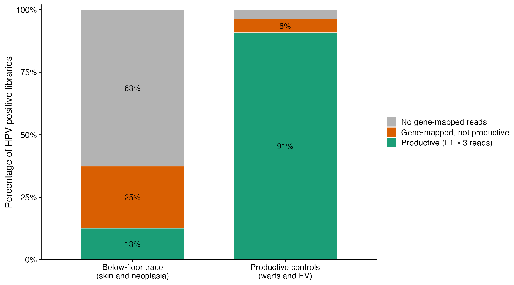
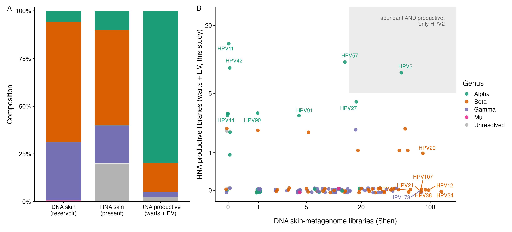
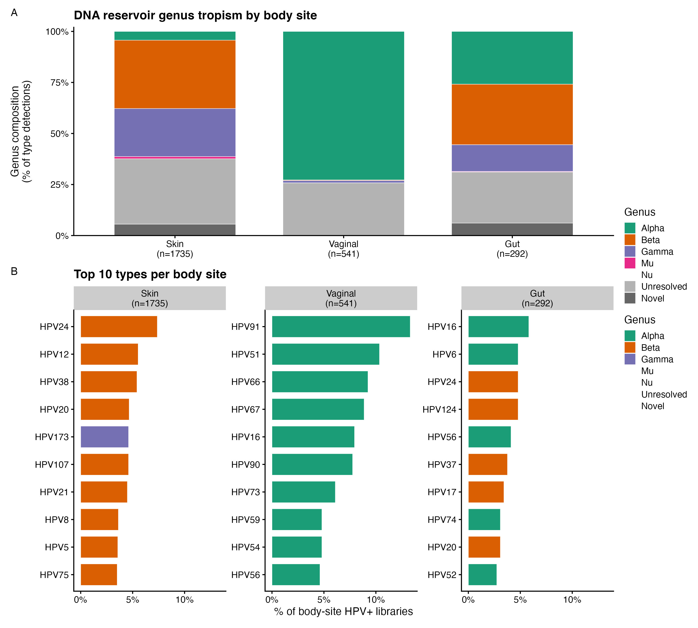
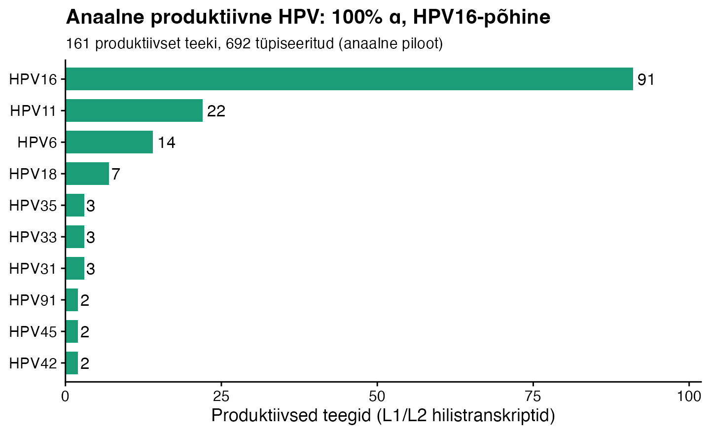

## Kolm osa

::: {.incremental}
1. **Mis on juba käsikirjas.** Avalike RNA-seq andmete taasanalüüs: nahavähi HPV on jälg, mitte produktiivne infektsioon
2. **Mis on juurde tehtud.** Sõltumatu DNA-andmestik (Shen/Logan) kinnitab ja teravdab tulemust; anaalne pilootuuring
3. **Mis käib.** Vaginaalne/emakakaela RNA-analüüs, limaskesta aktiivsuse telg
:::

::: {.notes}
Kaar: nahk (tehtud) → põhimõte (uued analüüsid) → limaskest (käimas).
:::

## Algsed hüpoteesid

**Keskne küsimus:** kas beeta-HPV on väljakujunenud nahavähis transkriptsiooniliselt aktiivne **tõukejõud** või vaid **„hit-and-run" jalajälg**?

::: {.incremental}
- **Hit-and-run.** β-HPV toimib varakult (UV-ga koos, kahjustab DNA-paranduse signaale), kuid väljakujunenud kasvaja jaoks on ta *ebavajalik* → jälg, mitte tõukejõud
- **Kaitsev immuunsus.** T-raku immuunsus kaitseb kommensaalsete papilloomiviiruste vastu; immuunsupressiooniga seotud cSCC = immuunjärelevalve tõrge
:::

## Algsed hüpoteesid: neli tööküsimust

::: {.incremental}
1. Millised HPV tüübid on levinud **terves nahas**?
2. Millised HPV tüübid on levinud erinevates **nahapatoloogiates**?
3. Millistes **ebatavalistes kudedes** leidub HPV transkripte?
4. Millistes transkriptoomides esineb viiruse **produktiivne faas** (hilised / L1 transkriptid)?
:::

## Küsimustest tulemusteni

Algsed küsimused on **nahakesksed**; käsikiri vastab neile:

::: {.incremental}
- **Q1** → vaikiv β/γ nahareservuaar
- **Q2 / Q4** → produktiivne soolatüügastes / EV-s, jälg nahavähis = **hit-and-run, mitte driver**
- **Q3** (ebatavalised koed) → HPV genoomid **soole** metagenoomides = perianaalnaha saaste
- **Anaalkanal / emakakael pole algsetes küsimustes.** Limaskesta töö on **uus suund**, mis kasvas välja DNA×RNA võrdlusest (produktiivne positiivne kontroll + lahknemise põhimõtte üldistus)
:::

# I osa: Käsikiri {background-color="#1b3a5b"}

## Küsimus ja lähenemine

**Küsimus:** kas naha-HPV on nahavähis (cSCC/AK) transkriptsiooniliselt aktiivne või vaid „hit-and-run" jälg?

**Lähenemine:** avalike inimese RNA-seq teekide taasanalüüs

::: {.incremental}
- igast teegist otsisime HPV-lugemeid (Kraken2)
- **saastet arvestav**: rakuliin / muundatud / primaarkude eristatud
- **sügavusega normeeritud**: HPV-lugemeid miljoni lugemi kohta (RPM), et eristada koormust sekveneerimissügavusest
:::

## Tulemus 1: signaal on suuresti rakuliini saaste {.smaller}

::: {.incremental}
- Rakuliini ja muundatud teegid on HPV+ **~5× sagedamini** kui primaarkoe teegid (P < 10⁻⁸)
- Need positiivsed on peaaegu ainult **HPV16 / HPV18**: integreerunud kõrge riskiga α-tüübid (HeLa, SiHa jt)
- Primaarnaha teekidest kannab HPV-d vaid **2–4 %**
:::

> Avalike transkriptoomide „HPV-küllus" on suures osas laborisaaste, mis tuleb enne igasugust levimusväidet eemaldada.

## Tulemus 2: nahavähk kannab vaid jälge {.smaller}

::: {.incremental}
- Nahavähk (cSCC/AK) jõuab tuvastuslävele vaid üksikutes teekides ja jääb **~6 suurusjärku madalamale** kui produktiivsed kontrollid
- ...ja seda **hoolimata ~4× sügavamast sekveneerimisest** võrreldes kontrollidega
- Sügavus tõstab *ükskõik millise* lugemi leidmise tõenäosust, aga **mitte** produktiivse taseme saavutamise tõenäosust
:::

> Populatsiooni tasemel on HPV nahavähis madala tasemega, transkriptsiooniliselt vaikiv jälg. Täpselt see, mida hit-and-run mudel ennustab.

## Sügavusega normeeritud HPV-koormus

{width="72%" fig-align="center"}

## Kontroll: kude, kus HPV paljuneda ei saa {.smaller}

Papilloomiviirus replitseerub ainult diferentseeruvas kihilises lameepiteelis. Rasvkoes, veres ja närvikoes ei saa seega olla infektsiooni.

::: {.incremental}
- **334 teeki**: 252 nahaaluse rasvkoe teeki + 82 vere-, leukotsüüdi-, neuroni- ja astrotsüüditeeki
- neist kannab HPV jälglugemeid **28,7 %**, nahal **27,8 %**: vahet ei ole
- üle tuvastusläve **0 %**, määratavaid HPV-tüüpe **0** (nahal 0,1 % üle läve)
:::

> Taustatase ei mõõda infektsiooni. See on **meetodi alumine lävi**, mis kordub täpselt samal tasemel koes, kus infektsioon on bioloogiliselt võimatu.

## Sama kontroll paljastab saaste {.smaller}

Kahes uuringus ületab HPV-signaal mitte-permissiivses koes **tuvastusläve**. Just seetõttu jäid nad kontrolltulbast välja.

::: {.incremental}
- **SRP565659** (naha T-rakuline lümfoom): nahk ja veri **samadelt patsientidelt, samas sekveneerimisjooksus**
- nahk 26 teeki: **88 % HPV+**, kuni 12,0 RPM (ootuspärane)
- veri ja lümfisõlm 42 teeki: **52 % HPV+**, kuni 3,6 RPM (bioloogiliselt võimatu)
- **SRP572742** (lihas + veri, 66 teeki): 83 % HPV+, 3 üle läve, kuni 5,3 RPM
:::

> Lugemid ilmuvad teekidesse, kus neil allikat ei ole, kõrge koormusega teekide kõrval samas jooksus. See on **indeksihüpe ja teekidevaheline ülekanne**, mitte infektsioon.

## Tulemus 3: test töötab, reservuaar on olemas, aga vaikiv

::: {.incremental}
- **Positiivsed kontrollid** (soolatüükad, epidermodysplasia verruciformis) on produktiivsed → analüüs *näeb* produktiivset infektsiooni, kui see on olemas
- Üksikud ehtsad produktiivsed β/γ nahainfektsioonid *esinevad*, aga jäävad nulltaustal erandiks
- Terve naha β/γ **reservuaar on reaalne, kuid transkriptsiooniliselt vaikiv**
:::

## Käsikirja kokkuvõte

::: {.callout-note appearance="minimal"}
Naha-HPV: **olemas, aga vaikiv**. Produktiivne haigus kuulub soolatüügastele ja EV-le; nahavähk kannab viirust (kui üldse) jäljena.
:::

## Aga kas „jälg" on müra või bioloogia? {.smaller}

Jaotasime alla läve jäävad HPV-lugemid varajasteks (E-geenid) ja hilisteks (L1/L2):

{width="60%" fig-align="center"}

**Enamik jäljest on k-meeri müra; reaalne vähemus on varajane (E6/E7) transkriptsioon ilma L1-ta: latentse reservuaari tunnus, mitte HeLa saaste.**

# II osa: Uued analüüsid {background-color="#1b3a5b"}

## Lünk: „olemas" jäi vaid järelduseks

::: {.incremental}
- Käsikiri näitab **„vaikiv"** otseselt (transkriptsiooni pole)
- ...aga **„olemas"** vaid nõrgalt: jälgedena tuvastusläve piiril, allpool määramisläve
- **„Olemas" on järeldus, mitte mõõtmine.** Vaikus sobib kokku mõlema seletusega: viirus on kohal, aga vaikib, või teda ei olegi. RNA üksi neid ei erista.
:::

## Idee: sõltumatu DNA-andmestik

**Shen jt: petabaasi mastaabis papilloomiviiruste kaardistus (Logan / kogu SRA)**

::: {.incremental}
- 27 miljonit SRA teeki
- 383 uut tüüpi 105 peremeesliigis
- **DNA-põhine** → mõõdab *kohalolu*, samas kui meie RNA-analüüs mõõdab *aktiivsust*
:::

Teegid ei kattu (DNA vs RNA), seega saame **võrrelda koosseisu, mitte andmestikke ühendada**.

## Tulemus: DNA kinnitab kohalolu otse {.smaller}

Naha DNA-reservuaar (Shen, HPV+ metagenoomid):

| Perekond | Osakaal naha teekidest |
|---|---|
| **Beeta** | **55,2 %** |
| **Gamma** | **40,7 %** |
| Alfa | 6,7 % |

> Vaikiv enamik **ongi** domineeriv β/γ kommensaalne DNA-reservuaar, mitte RNA-valimi artefakt.

## Tulemus: kohalolu ja aktiivsus **lahknevad** {.smaller}

::: {.incremental}
- DNA-s **sagedaseimad** tüübid (β: HPV24, HPV12, HPV107) on transkriptsiooniliselt **vaikseimad**
- **Produktiivsed** tüübid (α soolatüükatüübid HPV11/57/42/6) on DNA-s **haruldased**: nahas 0 DNA-tuvastust
- Ainult **HPV2** on korraga sage ja produktiivne
:::

> „Nahk on vaikiv" (fakt koe kohta) → **olemasolu ja aktiivsus on eraldi teljed** (fakt viiruse kohta).

## Joonis: kohalolu vs aktiivsus (nahk)

{width="88%" fig-align="center"}

## Tulemus: kudede tropism DNA-st

Reservuaar taastab õpikutropismi ainuüksi DNA põhjal:

::: {.incremental}
- **Vagiina: 84 % α** (limaskest, HPV91/51/66/67/16)
- **Nahk: β/γ** (kommensaal)
- **Sool: segu.** α (HPV16/6) **+ naha β** (HPV24/124) = perianaalnaha saaste *(sama signaal kui eluringi rektaalkaape-kohordis)*
:::

Uudsete klastrite osakaal: nahk 14,5 % · sool 9,6 % · vagiina 0,2 % → naha β/γ on kataloogides alaesindatud.

## Joonis: DNA-reservuaari tropism kehapaikade lõikes

{width="50%" fig-align="center"}

## Tulemus: anaalne RNA-pilootuuring {.smaller}

Puuduv **haigusega sobitatud kontroll**: soolatüügas on produktiivne, aga healoomuline. Kas α-HPV on produktiivne ka **kartsinoomis**, või summutab pahaloomuline kude tootmise alati?

::: {.incremental}
- 692 tüpiseeritud; **230 HPV+ (34 %)**, kordades üle naha 2–4 %
- 5 märgistatud rakuliini, **kõik HPV-negatiivsed**
- **164 produktiivset teeki**, tüübiga neist 161 ja **kõik α**: HPV16 (91), siis HPV11/6/18
- vastus on **kartsinoom vs kartsinoom**: nahavähis on HPV jälg, anaalvähis on ta rikkalikult produktiivne
:::

> Anaalne α-HPV on **peamiselt produktiivne** (HPV16, nagu emakakael), naha β-tüübid soole/anaali DNA-s on aga **vaikivad**.

**Piirang:** 164 produktiivsest teegist on 115 selgelt kasvaja/SCC/CIN ja **vaid 1 on kontroll**, seega terve anaallimaskesta kohta see midagi ei ütle. Just selle lähtetaseme võiks anda emakakaela poolel 469 stratifitseeritud normaalset/kontrollteeki.

## Joonis: anaalne produktiivne HPV

{width="66%" fig-align="center"}

## Kontseptuaalne panus

::: {.callout-important appearance="minimal"}
**„Naha-HPV on vaikiv"** →
**„HPV kohalolu ja produktiivne aktiivsus on eristatavad ning lahknevad *perekonna* ja *anatoomilise niši* järgi."**
:::

::: {.incremental}
- limaskesta **α** on produktiivne seal, kus ta esineb (emakakael, anaalkanal)
- naha **β/γ** on vaikiv reservuaar kõikjal, kus ta esineb (nahk; ja kontaminatsioonina soole/anaali DNA-s)
- kaks sõltumatut avalikku arhiivi (RNA-aktiivsus × DNA-kohalolu)
:::

## Kohalolu ≠ aktiivsus: kaks „aktiivsuse" telge {.smaller}

Põhimõte **ei ole uus**: see on HPV bioloogia alustala. Kuid „aktiivsusel" on kaks eri telge:

| Olek | DNA | E6/E7 *(transformeeriv)* | L1/L2 *(produktiivne)* |
|---|:---:|:---:|:---:|
| Latentne kommensaal *(terve nahk)* | + | – | – |
| Produktiivne *(soolatüügas)* | + | + | **+** |
| Integreerunud vähk *(cSCC)* | + | **+** | **–** |

**Meie telg = produktiivne (L1/L2), mitte onkogeenne (E6/E7).** Need on omavahel lahknenud: integreerunud vähk on E6/E7-aktiivne, kuid L1-vaikne → meie loeme selle „jäljeks" (Moody 2010).

## Kirjanduses killustatud: meil ühendatud {.smaller}

Kirjandus näitab „kohalolu ≠ aktiivsus" eraldi vaatlustena, niši kaupa:

::: {.incremental}
- latentsus / „twilight zone" (Doorbar 2023); diferentseerumisest sõltuv elutsükkel, kus L1/L2 avaldub vaid suprabasaalkihis (Doorbar 2012)
- DNA vs E6/E7 mRNA sõeluuringus (mRNA-testid spetsiifilisemad); integratsioonil kaob L1 (Moody 2010)
- hit-and-run: β-koormus kõrgeim varastes kolletes, langeb vähis (Borgogna 2018); HPV vaikne cSCC-s (Arron 2011)
:::

**Uudne meil:** DNA × RNA kogu SRA mastaabis · tüübi tasemel **antikorrelatsioon** · ühtne **perekonna × niši** seaduspära.

# III osa: Käimasolev töö {background-color="#1b3a5b"}

## Limaskesta test

Vaginaalne **DNA-reservuaar** on 84 % α (HPV91/51/66/67/16).

**Küsimus:** kas need DNA-s sagedased tüübid on samas koes ka **produktiivsed**?

::: {.incremental}
- see on sama koe *kohalolu-vs-aktiivsuse* sidumine, mida seni saime teha vaid naha jaoks
- limaskesta ennustus: nad **langevad kokku** → emakakael = **puhas vastand nahale** (nišš, kus kohalolu *ennustab* aktiivsust)
:::

## Praegune seis: vaginaalne/emakakaela analüüs {.smaller}

::: {.incremental}
- **12 764** emakakaela/vagiina teeki, 12 316 uut
- **6 839 (55,5 %) rakuliinid** (HeLa/SiHa/CaSki + muundatud)
- puhast kude **5 477**; kõigi tüpiseerimine võtaks ~19 päeva
- tüpiseerime **juhuvalimi 1 000 teeki** **+ 469 stratifitseeritud normaalset/kontrollteeki**
:::

## Miks juhuvalim, mitte esimesed tükid? {.smaller visibility="hidden"}

::: {.incremental}
- proovitabel on **uuringute kaupa kobaras**, seega esimesed tükid ei oleks juhuvalim, vaid paar üksikut uuringut
- piirav suurus ei ole tüpiseeritud teekide arv, vaid **HPV+ teekide arv**: koosseisu ±5 % täpsuseks kulub ~384 HPV+
- HPV+ määra 20–35 % juures tähendab see ~1 100–1 900 tüpiseeritut; **1 000 on kindel esimene läbimine** (±5–7 % sagedasematel tüüpidel) ja mõõdab ühtlasi ära HPV+ määra
- valimit saab **sammhaaval suurendada** sama segamise järgmise plokiga
- raskusastme gradient vajab kihistamist: normaalne ~2,5 % ja kontroll ~7 % hulgast → juhuvalim annaks vaid ~25 ja ~70 teeki, sellest eraldi **469 kihistatud teeki**
:::

## Mida vaginaalne analüüs lahendab

::: {.incremental}
1. **Vaginaalne kohalolu-vs-aktiivsuse sidumine**: kas DNA-s sagedased α-tüübid on produktiivsed (limaskesta vastand nahale)
2. **Kõrge ja madala riskiga tüüpide gradient**: kas HPV16/18/31/33/45 domineerivad produktiivset ekspressiooni haiguse raskusastme (normaalne → CIN → kartsinoom) järgi
:::

## Arutelukoht

Kuidas uus töö käsikirjaga suhestub?

::: {.incremental}
- **(A) Liita.** DNA kui ortogonaalne tugi praegusele RNA-tööle (tugevdab, ei muuda sõnumit)
- **(B) Tõsta.** Sõnastada käsikiri ümber lahknemise põhimõttest lähtuvalt (suurem lugu, vajab vaginaalset)
- **(C) Eraldada.** Praegune käsikiri jääb; lahknemise põhimõte omaette kaaslasartiklina (vaginaalne valmis)
:::

## Kokkuvõte

::: {.incremental}
- **Käsikiri:** naha-HPV on olemas, aga vaikiv; produktiivne soolatüügastes; nahavähis jälg
- **Uus:** sõltumatu DNA kinnitab kohalolu ja paljastab lahknemise perekonna ja niši järgi
- **Käimas:** emakakaela analüüs näitab, kas limaskestal kohalolu ja aktiivsus kattuvad → puhas vastand nahale
:::

::: {.callout-tip appearance="minimal"}
Peamine sõnum: **kohalolu ≠ aktiivsus**, ja see lahkneb süstemaatiliselt perekonna ja anatoomilise niši järgi.
:::
